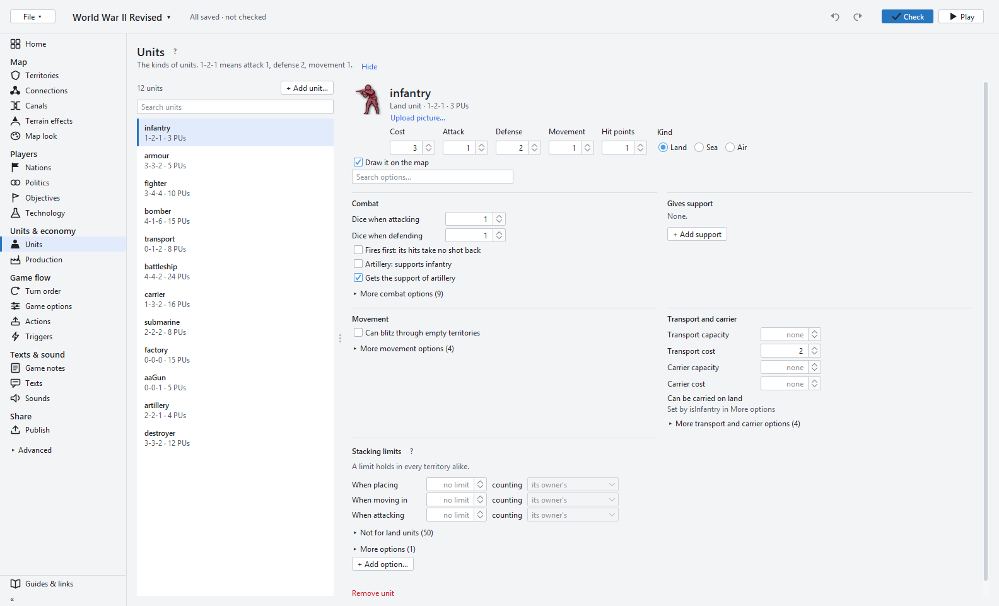
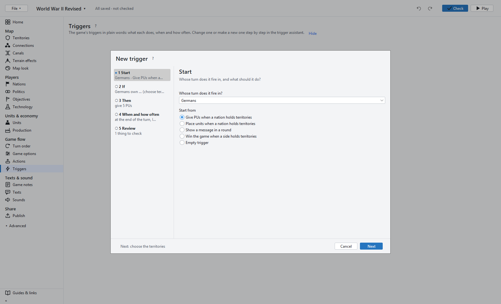

<p align="center">
  
</p>

<h1 align="center">Eddie's Map Editor</h1>

<p align="center">
  <b>Make maps for <a href="https://github.com/triplea-game/triplea">TripleA</a> on one screen, without editing a single file by hand.</b>
</p>

<p align="center">
  <a href="https://github.com/xXEddieXxx/eddies-map-editor/releases/latest/download/eddies-map-editor-windows.zip"><b>⬇️ Download for Windows</b></a>
  &nbsp;·&nbsp;
  <a href="https://github.com/xXEddieXxx/eddies-map-editor/releases/latest/download/eddies-map-editor-macos.zip"><b>⬇️ Download for macOS</b></a>
  &nbsp;·&nbsp;
  <a href="https://github.com/xXEddieXxx/eddies-map-editor/releases/latest">All downloads</a>
  &nbsp;·&nbsp;
  <a href="https://buymeacoffee.com/xeddie">☕ Buy me a coffee</a>
</p>

An editor for TripleA map makers: start a new map from a picture or open an existing map
folder, then shape its territories, nations, units and rules with forms and clicks on the map.
It runs with your installed TripleA, and the maps it saves still load and play there.


## Get started

1. **Windows:** download
   [`eddies-map-editor-windows.zip`](https://github.com/xXEddieXxx/eddies-map-editor/releases/latest/download/eddies-map-editor-windows.zip),
   unzip it anywhere and start `Eddies Map Editor.exe`. It brings its own Java and runs with your
   installed [TripleA](https://triplea-game.org/download/), which it finds or asks for. It needs a
   TripleA from June 2026 or newer and says so at its start when yours is older.
2. **macOS (Apple silicon):** download
   [`eddies-map-editor-macos.zip`](https://github.com/xXEddieXxx/eddies-map-editor/releases/latest/download/eddies-map-editor-macos.zip),
   unzip it and open `Eddies Map Editor.app`. It brings its own Java and needs TripleA installed.
   It is not signed: the first time, right-click it and choose *Open*, or allow it under
   *System Settings › Privacy & Security*.
3. **Linux and Macs with Intel:** download `eddies-map-editor-<version>.zip` from the
   [latest release](https://github.com/xXEddieXxx/eddies-map-editor/releases/latest), install
   [Java 25](https://adoptium.net/) and TripleA, and start `bin/eddies-map-editor`.
4. On the start page, open a map folder (or a recent map), or make a new one. Maps are kept in
   TripleA's maps folder, where TripleA finds them.
5. **Play (F7)** tries the map in your installed TripleA, the version your players use;
   *File → Play with…* picks another.

Each release names the TripleA release it was tested with.

## What it does

**Home** shows the next step to a playable map and opens the right tool for it. Every change can
be undone, and a save writes only what changed, keeping the first version of each file as `.bak`.

**Territories & map**
- Find territories and sea zones in a picture; draw and erase borders, split and merge territories.
- Set owners, PUs, capitals and starting units, one territory at a time or with a paint brush.
- Neighbours, canals and terrain effects, with a check that finds missing connections.
- Place units, names, flags and markers by dragging them, or right-click a territory to add or
  move a place; lay out unit places for the whole map at once.
- Paint textures and create a relief; resize the whole map; update the small map.

**Nations & units**
- Nations with alliance, colour (shown as in the game), flag, starting PUs and their own rules.
- Diplomacy at the start, national objectives and technologies.
- Unit types with cost, combat values and every ability in plain words; unit pictures per nation,
  tinted in the nation's colour.
- What each nation can buy and repair, resources and the buy window's tabs.



**Rules & triggers**
- Turn order in plain words, game options with a "?" for each, political and user actions.
- A trigger assistant that builds a trigger step by step, starting from examples like
  *Give PUs when a nation holds territories*.
- Game notes, texts and sounds; every other attachment in a table.



**Check & play**
- **Check (F6)** loads the map as TripleA does, plays its first round in memory and lists what
  would stop it, each problem with a way to the tool that fixes it.
- **Play (F7)** saves, runs the same check on the saved files, then starts TripleA with the map,
  or says why it would not start.

**Share**
- **Publish** sets the map's name, version, description and preview, lists what is still missing
  before an upload, and links TripleA's upload guide.
- **Export** zips the map without the `.bak` files.

## Support the project

Eddie's Map Editor is made in my spare time and is free. If it saves you an evening of editing
XML, you can buy me a coffee.

<p align="center">
  <a href="https://buymeacoffee.com/xeddie"><b>☕ Buy me a coffee</b></a>
</p>

Bug reports, ideas and feedback are just as welcome in the
[issue tracker](https://github.com/xXEddieXxx/eddies-map-editor/issues).

## For developers

### Requirements

- **JDK 25.** Gradle runs with the Java in `JAVA_HOME`.
- **An installed TripleA.** The editor uses TripleA's engine (map XML model, game parser, unit
  pictures and look) from its jar, `bin/game-headed-*.jar`. Gradle looks in
  `%ProgramFiles%/TripleA` (macOS: `/Applications/TripleA.app/Contents/app`); for another place
  pass `-PtripleaHome=<folder>`, eg the unzipped `game-headed.zip` of a
  [TripleA release](https://github.com/triplea-game/triplea/releases).

### Run, test, package

```bash
./gradlew run       # start the editor
./gradlew test      # the tests
./gradlew appZip    # the program with its own Java, for this system, in build/distributions
./gradlew distZip   # the zip for every system, needs Java 25
```

### Release

The **Release** workflow builds releases: *Actions → Release → Run workflow*, enter the version
(eg `1.2.0`) and, if needed, the TripleA release to build with (default: the newest). It runs the
tests, builds the Windows program, the Mac program (Apple silicon, not signed) and the zip for
every system, and publishes them as release `v<version>`. The *Download* links above always point
to the newest one.

### Where things are

All code is in `src/main/java/eddies/mapeditor`, the tests in `src/test/java/eddies/mapeditor`.
[AGENTS.md](AGENTS.md) maps every class and explains how the editor works and its rules.

## License

GPL-3.0, like TripleA, whose code this editor builds on. See [LICENSE](LICENSE).
