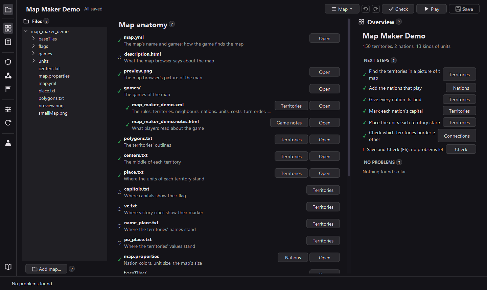
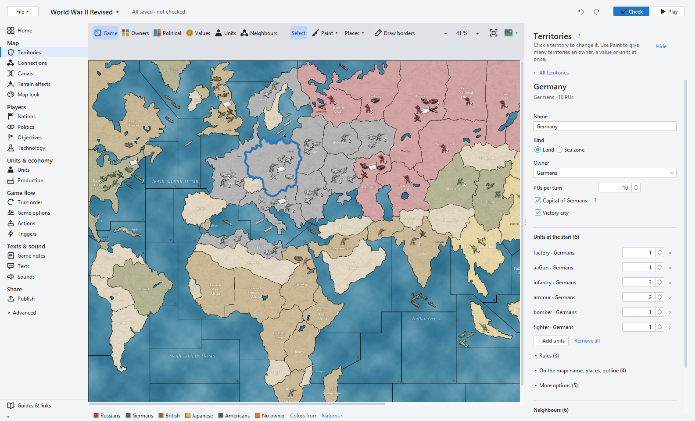

<p align="center">
  
</p>

<h1 align="center">Eddie's Map Editor</h1>

<p align="center">
  <b>Make maps for <a href="https://github.com/triplea-game/triplea">TripleA</a> on one screen, without editing a single file by hand.</b>
</p>

<p align="center">
  <a href="https://github.com/xXEddieXxx/eddies-map-editor/releases/latest/download/eddies-map-editor-windows.zip"><b>⬇️ Download for Windows</b></a>
  &nbsp;·&nbsp;
  <a href="https://github.com/xXEddieXxx/eddies-map-editor/releases/latest">All downloads</a>
  &nbsp;·&nbsp;
  <a href="https://buymeacoffee.com/xeddie">☕ Buy me a coffee</a>
</p>

TripleA is the open source turn-based strategy game. Make a new map from a picture or open an
existing map folder. Then change its territories, nations, units and rules, and play it.





## Get started

1. **Windows:** download
   [`eddies-map-editor-windows.zip`](https://github.com/xXEddieXxx/eddies-map-editor/releases/latest/download/eddies-map-editor-windows.zip),
   unzip it anywhere and start `Eddies Map Editor.exe`. It brings its own Java and runs with your
   installed [TripleA](https://triplea-game.org/download/), which it finds by itself or asks for.
2. **macOS and Linux:** download `eddies-map-editor-<version>.zip` from the
   [latest release](https://github.com/xXEddieXxx/eddies-map-editor/releases/latest), install
   [Java 25](https://adoptium.net/) and TripleA, and start `bin/eddies-map-editor`.
3. On the start page, open a map folder, create an empty map, or make a new one from a picture.
   The editor opens and saves maps in TripleA's maps folder, where TripleA finds them.
4. **Play (F7)** tries the map. It starts your installed TripleA if the editor finds one, so you
   test in the version your players use. *Map → TripleA for Play…* picks another TripleA.

Each release names the TripleA release it was tested with.

## What it does

- **Start a map:** open a map folder, create an empty map, or let a wizard build a new map from a
  picture. The editor writes every file a map needs: `map.yml`, the game XML, `polygons.txt`,
  `centers.txt`, `place.txt`, `map.properties`, tiles, flags and unit pictures.
- **Territories:** find them in the picture (areas between dark lines; blue areas are sea zones).
  Rename them one at a time or many at once. Set owners, PUs, capitals, victory cities and starting
  units, or paint them on the map with brushes. *Move places* shows where the game draws a
  territory's units, name, PUs, capital flag and victory city marker: drag them, add or remove
  places for units (right-click or Delete).
- **Redraw borders:** draw new borders into the map's picture in any paint program, then choose
  *Picture ▾ → Redraw borders from a picture…*. Names, owners and units stay;
  territories whose border moved get their places found again.
- **Connections, nations, units, game options, turn order and game notes,** each in its own tool.
- **Map look:** unit size, scrolling, what the map shows (map.properties), and a relief picture
  cut into relief tiles.
- **Unit pictures:** upload a picture for a unit type, or import a whole folder of pictures for one
  nation, for example another map's `units/Germans`.
- **The map as the game shows it:** owners, values, units and connections views, with a legend.
  Territories with a problem have a red outline.
- **Files:** an IDE-style file browser with a text editor that checks your files as you type. Add
  other maps' folders to copy from them.
- **Check (F6)** loads the game the way TripleA does, **Play (F7)** starts TripleA with it, and
  **Export** zips the map for sharing.
- **Undo and redo** for every change. A save writes only what changed, and the first version of
  each file is kept as `.bak`.

## Support the project

Eddie's Map Editor is made in my spare time and is completely free. If it saves you an evening of
editing XML, you can buy me a coffee.

<p align="center">
  <a href="https://buymeacoffee.com/xeddie"><b>☕ Buy me a coffee</b></a>
</p>

Bug reports, ideas and feedback are just as welcome, see the
[issue tracker](https://github.com/xXEddieXxx/eddies-map-editor/issues).

## For developers

### Requirements

- **JDK 25.** Gradle runs with the Java in `JAVA_HOME`.
- **An installed TripleA.** The editor uses TripleA's engine (map XML model, game parser, unit
  pictures and look) from its jar, `bin/game-headed-*.jar`. Gradle looks in
  `%ProgramFiles%/TripleA` (macOS: `/Applications/TripleA.app/Contents/app`); for another place pass `-PtripleaHome=<folder>`, eg the unzipped
  `game-headed.zip` of a [TripleA release](https://github.com/triplea-game/triplea/releases).

### Run, test, package

```bash
./gradlew run       # start the editor
./gradlew test      # the tests
./gradlew appZip    # the program with its own Java, for this system, in build/distributions
./gradlew distZip   # the zip for every system, needs Java 25
```

### Release

Releases are built by the **Release** workflow: *Actions → Release → Run workflow*, enter the
version (eg `1.2.0`) and, if needed, the TripleA release to build with (default: the newest). It runs the
tests, builds the Windows program and the zip for every system, and publishes them as release
`v<version>`. The *Download for Windows* link above always points to the newest one.

### Where things are

All code is in `src/main/java/eddies/mapeditor`:

| Class                                                                       | What it is                                                                                    |
|-----------------------------------------------------------------------------|-----------------------------------------------------------------------------------------------|
| `EddiesMapEditor`                                                           | Starts the editor                                                                             |
| `MapMakerWindow`                                                            | The window: tool strip, file browser, the map or a preview in the middle, the tool's panel    |
| `MapProject`                                                                | The open map: its game and files, undo and redo, saving                                       |
| `MapXml`                                                                    | Reads and changes the game XML model; each change makes a new model                           |
| `MapFiles`, `MapFolder`                                                     | The files beside the game XML: outlines, centers, pictures, `map.properties`                  |
| `MapPicture`                                                                | Finds territories, sea zones and neighbours in a picture                                      |
| `MapCanvas`, `MapView`                                                      | The map on screen                                                                             |
| `PlayWith`                                                                  | Which TripleA Play starts                                                                     |
| `OverviewEditor`, `TerritoriesEditor`, `NationsEditor`, `UnitsEditor`, ...  | The tools                                                                                     |

## License

GPL-3.0, like TripleA, whose code this editor builds on. See [LICENSE](LICENSE).
