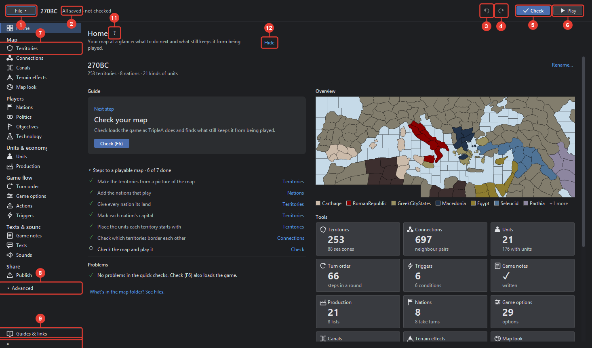

# Eddie's Map Editor

**A map editor for TripleA.** Turn a picture into territories, give nations their land, units
and rules, and play the map in TripleA, without writing XML by hand. This site is the user
guide: a page for every tool, with pictures.

[Download the editor](https://github.com/xXEddieXxx/eddies-map-editor/releases/latest){ .md-button .md-button--primary }
[Make your first map](getting-started.md){ .md-button }

## What you can do with it

- **Territories from a picture.** Draw borders as dark lines, the editor finds the territories,
  sea zones and neighbours. Draw, erase, split and merge later.
- **Owners, values and units** one territory at a time or with a paint brush. Capitals, victory
  cities, places for names and flags.
- **Nations** with alliance, colour, flag, starting PUs and their own rules. Diplomacy,
  objectives, technologies.
- **Units** with cost, combat values and every ability in plain words, and what each nation can
  buy.
- **The round**: the turn order, game options, political actions, and a trigger assistant that
  builds triggers step by step.
- **Check and Play.** Check loads the map as TripleA does and says what stops the game; Play
  starts TripleA with your map.

## Start here

- [**Getting started: your first map**](getting-started.md)

    A small map from a picture to a game you can play, step by step, with an example picture.

- [**The window**](#the-window)

    The header, the sidebar, the map beside the tools, the keys, saving and undo.

- [**New map**](new-map.md)

    The wizard that starts a map from a picture in three steps.

- [**Home**](home.md)

    What to do next, the problems, the overview and a tile per tool.

- [**Menus**](menus.md)

    The File menu, the map picture menu, View, Paint, Places, Sort and the ⋯ list.

## The tools

Every tool has a page that describes each of its controls.

- **Map**

    [Territories](territories.md) owners, PUs, units, places, borders ·
    [Connections](connections.md) ·
    [Canals](canals.md) ·
    [Terrain effects](terrain-effects.md) ·
    [Map look](map-look.md) unit size, markers, relief, Resize map

- **Players**

    [Nations](nations.md) alliance, colour, flag, PUs, rules ·
    [Politics](politics.md) how pairs start ·
    [Objectives](objectives.md) ·
    [Technology](technology.md)

- **Units & economy**

    [Units](units.md) every unit type, every option ·
    [Production](production.md) what nations buy and repair, resources, buy window tabs

- **Game flow**

    [Turn order](turn-order.md) the steps of a round ·
    [Game options](game-options.md) ·
    [Actions](actions.md) political and user actions ·
    [Triggers](triggers.md) and the trigger assistant

- **Texts & sound**

    [Game notes](game-notes.md) ·
    [Texts](texts.md) objective texts, messages, tool tips ·
    [Sounds](sounds.md)

- **Share & advanced**

    [Publish](publish.md) name, version, description, upload ·
    [Attachments](attachments.md) every attachment as the game file has it ·
    [Files](files.md) the map's files on disk

## The window

1. **File** opens the [File menu](menus.md#file-menu): open, new, recent, rename, export, publish,
   play with, the folder, close, Show all options.
2. **Save state.** "All saved", or "• Not saved" in orange, and "not checked" until Check ran. The
   **Save** button appears beside it once there is something to save.
3. **Undo (Ctrl+Z)** takes the last step back. Every change is a step, also a save does not end
   the chain.
4. **Redo (Ctrl+Y)** does it again.
5. **Check (F6)** loads the map as TripleA does, plays the first round in memory and lists what
   stops the game. The result shows as a pill beside the save state and on Home.
6. **Play (F7)** saves, runs the same check on the saved files and starts TripleA with the map.
7. **The sidebar** lists the tools in groups: Home, Map, Players, Units & economy, Game flow,
   Texts & sound, Share. Alt+1 to Alt+9 open the first nine. The chosen tool has a bar at its
   left.
8. **Advanced** folds the Attachments and Files tools in and out. The editor remembers it.
9. **Guides & links** opens TripleA's map making guides and the places to ask for help.
10. **«** at the bottom of the sidebar shows icons only, to give the map room; the icons' tool
    tips still name the tools.
11. **?** beside a tool's title explains the tool. Many fields have their own "?".
12. **Hide** hides the hint line under the title. The "?" still has it.

One of Check, Save and Play is highlighted: the one that comes next.

### The map beside the tools

Most tools show the map. Its toolbar, views and legend are described on the
[Territories](territories.md#the-map-and-its-toolbar) page, since that tool uses them most. The
row under the toolbar shows a goal while you follow a step of Home's guide, and a progress bar
while the map's picture is read from its tiles or a resize works.

### Keys

| Key | Does |
| --- | --- |
| Ctrl+O | Open a map |
| Ctrl+N | New map |
| Ctrl+S | Save |
| Ctrl+Z, Ctrl+Y | Undo, Redo |
| F6 | Check |
| F7 | Play |
| F8 | Export as zip |
| Ctrl+W | Close map |
| Alt+1 … Alt+9 | The first nine tools |
| Ctrl+0 | Fit the map |
| Ctrl+wheel | Zoom the map |
| Delete | In a table: remove the chosen row |

### Saving and undo

Every change is a step. Undo takes it back, also after a save. Save writes only what changed and
keeps the first version of each file in the editor's Backups folder, `eddies-map-editor/Backups`
in your home folder, a folder per map. The Save button's tool tip lists what the next
save writes, for example "Saves 3 files: 300BC.xml, place.txt, map.properties". A save never
writes a half file: it writes beside the file and moves it into place.

### "More" rows and Show all options

Options the game reads rarely sit behind a "▸ More … options (n)" row. Click it to open it; the
editor remembers which rows are open. **Show all options** in the File menu opens every such row
in every tool, now and next time.

### Lists and search

A tool with many things, such as Territories or Units, has a list on the left with a search
field above it. Type a part of a name. Where the list has groups, a header row folds a group.
Click a row to choose it; the right side then shows what it has, with "← All …" at the top to go
back to the list.

## When something goes wrong

!!! tip "A unit shows as a name badge on the map"
    The editor found no picture for it: none in `units/<nation>/`, none in `units/` itself, and
    none among the game's own. Upload one in Units.

!!! tip "Gives support says None, stacking limits are blank"
    The support or limit may be written in Attachments for every unit or nation of a variable
    (`foreach`); the tools show those read-only.

!!! tip "A size in Resize map is greyed out"
    The picture is not saved yet: save first, then it is resized from its tiles at any size.

!!! tip "The game does not start"
    Check (F6) says why and links the tool.

!!! tip "The toolbar's words are cut, like \"Draw bord…\""
    The window is narrow for the inspector shown; widen it, or hide the sidebar's words with «.

Found a bug or miss a feature? Open an issue at
[github.com/xXEddieXxx/eddies-map-editor/issues](https://github.com/xXEddieXxx/eddies-map-editor/issues).

## About this guide

The pages use the editor's own words: a heading is a tool or a control as you see it on screen.
A picture has red numbers at the controls, and the list below the picture explains them in that
order. The pictures show the dark theme; the editor follows TripleA's look, so with a light
TripleA it is light, with the same controls in the same places. For installing the editor see the
[README on GitHub](https://github.com/xXEddieXxx/eddies-map-editor#get-started); each release
names the TripleA release it was tested with.
