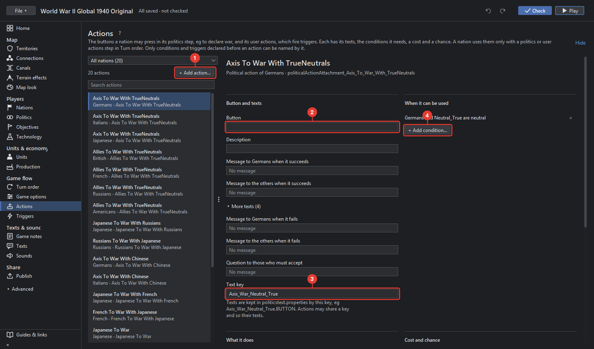
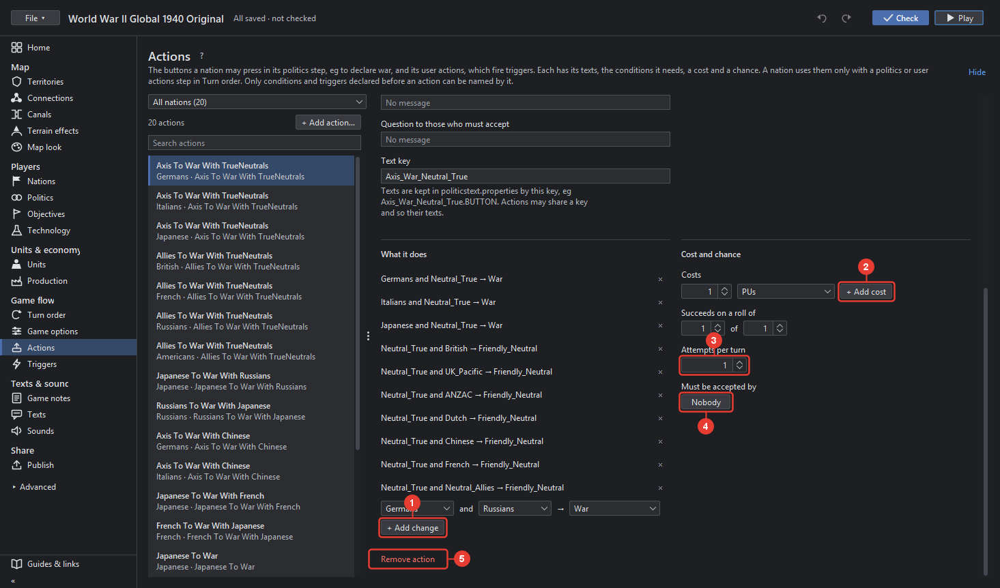

# Actions

[← Guide](README.md)

The buttons a nation may press in its politics step, for example to declare war, and its user
actions, which fire triggers. Each has its texts, the conditions it needs, a cost and what it
does. The picture shows WW2 Global 1940's "Axis To War With TrueNeutrals".

1. **+ Add action…** makes a political or a user action for a nation. The list on the left
   names the actions; the header of a chosen one says whose it is and its name in the game file.
2. **Button and texts**: **Button** is the text on the button players press; **Description**
   its tool tip; **Message to the nation when it succeeds**, **Message to the others when it
   succeeds**; under More texts: the messages when it fails, and the **Question to those who must
   accept**.
3. **Text key**: the texts are kept in politicstext.properties by this key, for example
   Axis_War_Neutral_True.BUTTON. Actions may share a key and so their texts.
4. **When it can be used**: the conditions the action needs, each a sentence; × removes one,
   **+ Add condition…** adds one of the map's.

1. **What it does**: for a political action, the relationship changes, each "A and B → type";
   × removes one; **+ Add change** adds how two nations stand when it succeeds. A user action
   fires triggers instead, listed here.
2. **Cost and chance**: **Costs**, what an attempt costs in each resource, **+ Add cost**.
3. **Succeeds on a roll of** n **of** m: the chance; all of one die means always.
4. **Attempts per turn**: how often the nation may try.
5. **Must be accepted by**: nations that must agree, for example the other side of an alliance;
   **Nobody** by default.
6. **Remove action** takes it out of the game.
