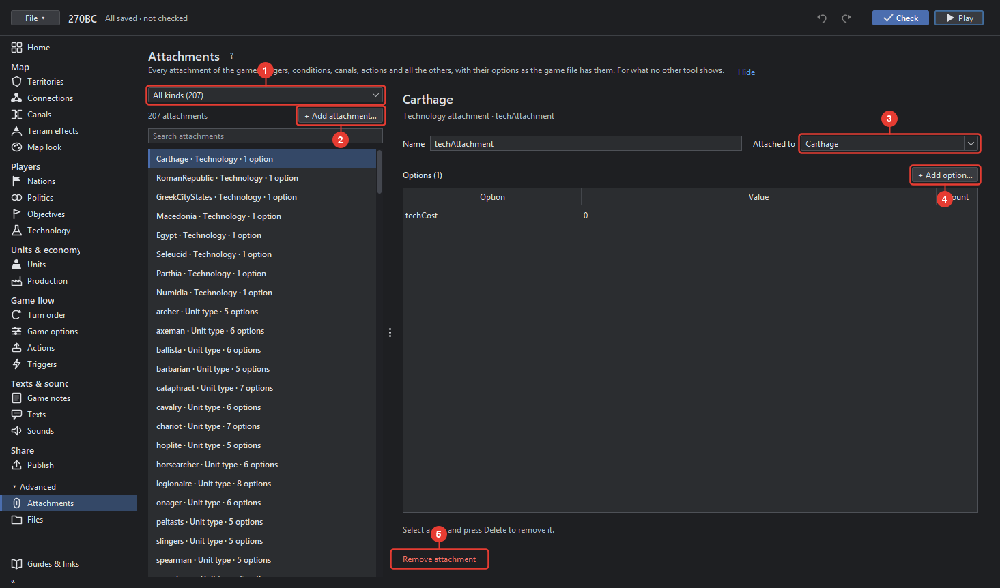

# Attachments

[← Guide](README.md)

Every attachment of the game: triggers, conditions, canals, actions and all the others, with
their options as the game file has them. For what no other tool shows, and for attachments
written once for every element of a variable (`foreach`), which the other tools show read-only.

1. **Which kind of attachments are listed**: all, or one kind, for example the unit attachments
   or the triggers. The list counts them and names each by what it is attached to.
2. **+ Add attachment…** adds one of a kind you choose, attached to a territory, a nation, a
   unit type or the game.
3. **Name** of the attachment, which TripleA reads it by, for example supportAttachment… for a
   support; **Attached to** the thing it belongs to.
4. **Options (n)**: a table of the attachment's options, each **Option**, its **Value** and,
   where the game file has one, its count. Edit a cell in place. **+ Add option…** adds an option
   by its name, chosen from the ones TripleA's class takes. Select a row and press Delete to
   remove it.
5. **Remove attachment** takes it out of the game. The editor refuses when a trigger or a
   condition still names it, and says where.

An attachment with a `foreach` stands for one per element of the variable it names; the header
says "for each …". Its options may use `@Variable@` for the element and `$Variable$` for all
elements joined. The variables themselves are listed in the Game options tool's variables, where
one is added or removed.
