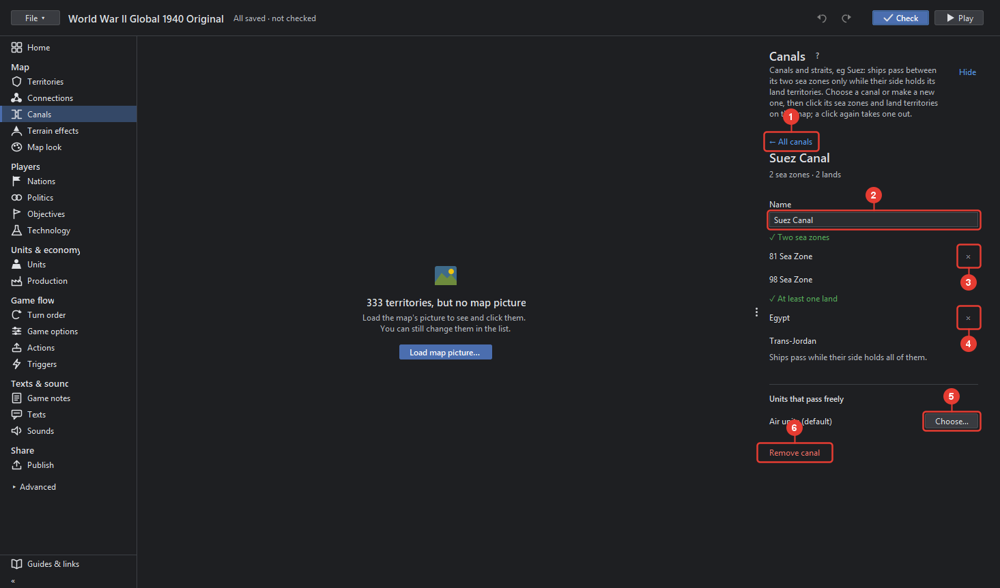

# Canals

[← Guide](README.md)

Canals and straits, for example Suez: ships pass between the canal's two sea zones only while
their side holds its land territories. The picture shows WW2 Global 1940, whose Suez Canal joins
sea zones 81 and 98 across Egypt and Trans-Jordan.

1. **← All canals** goes back to the list. The list counts the canals and has **+ Add canal…**:
   name it, then click its sea zones and land on the map.
2. **Name** of the canal, as the game file names it.
3. **Two sea zones**: the sea zones ships pass between. Click a sea zone on the map to add it, ×
   takes it out. A canal needs exactly two.
4. **At least one land**: the territories whose owners control the canal. Click land on the map
   to add it, × takes it out. Ships pass while their side holds all of them.
5. **Units that pass freely**: unit types the canal never stops, air units by default. **Choose…**
   ticks unit types, and the game's variables of unit types, `$Planes$` say, below them.
6. **Remove canal** takes the canal out of the game.

Without a map picture, as in the picture above, the right side still works; the map says "Load the
map's picture to see and click them".
