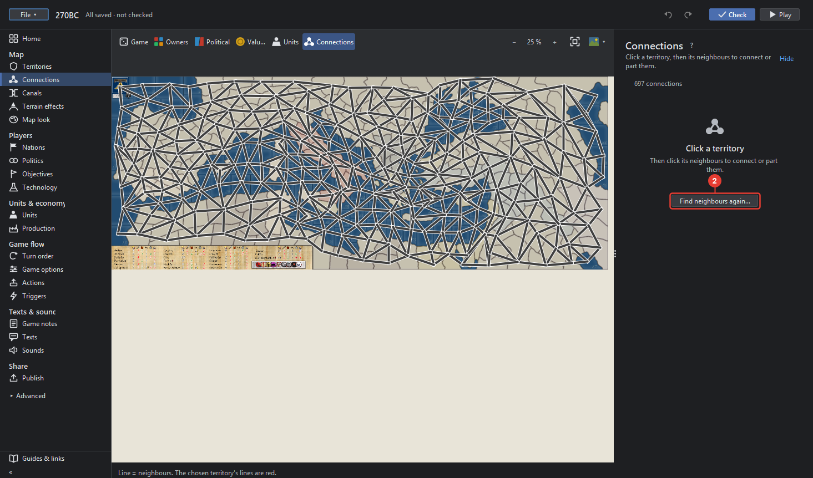

# Connections

[← Guide](README.md)

Which territories are neighbours. Units move only between connected territories, so a missing
connection is an island.

1. **View: Connections** is chosen for you: every connection is a line between the middles of two
   territories. The chosen territory's lines are red.
2. **Find neighbours again…** compares the connections with the territories' outlines: which
   touch without a connection, and which connections join territories that do not touch. The
   result lists both under **Problems** and **Worth a look**, each with **Show**, and offers to
   add or remove them.

How to use it: click a territory, then click its neighbours. A click on a territory that is not
connected connects it, a click on one that is parts them. The right side counts the connections
and shows the chosen territory's neighbours.

Check (F6) also finds territories without a connection, and Home's guide has a step for it.
