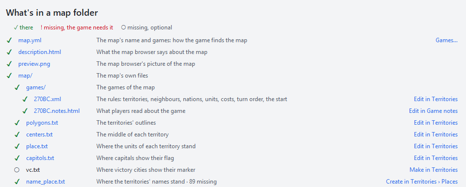

# Files

[← Guide](README.md)

The map's files as on disk. Open one to change it; the game's files are checked as you type.
Save file keeps the first version in the editor's Backups folder and reads the map again.

1. **⋯ More**: open the map's folder, reload the map from its files, and the folder of the game.
2. **What's in a map folder** lists every file a map has or could have, in its place in the
   folder, with ✓ there, ! missing and needed, ○ missing and optional, and a line that says what
   it is for. Click a file's name to open it in the editor on the right.
3. **Games…** beside map.yml lists the map's games, each to rename; the map name stays, since
   the games find the map by it.
4. **Edit in …** at the right of a file opens the tool that edits it, for example Edit in
   Territories for polygons.txt, Edit in Nations for flags, Make in Map look for reliefTiles.

The editor on the right is a text editor with colouring, line numbers, folding, find (Ctrl+F)
and a size and theme that follow the editor. A game file or a place file is checked as you type:
a line that TripleA would not read is marked and explained. **Save file** writes the file, keeps
the first version in the editor's Backups folder, and reads the map again from its files, asking
first when the map has unsaved changes. Pictures open in a viewer. The toast after the first save
of a file has **Show**, which lists the map's Backups folder in the tree, read only.
