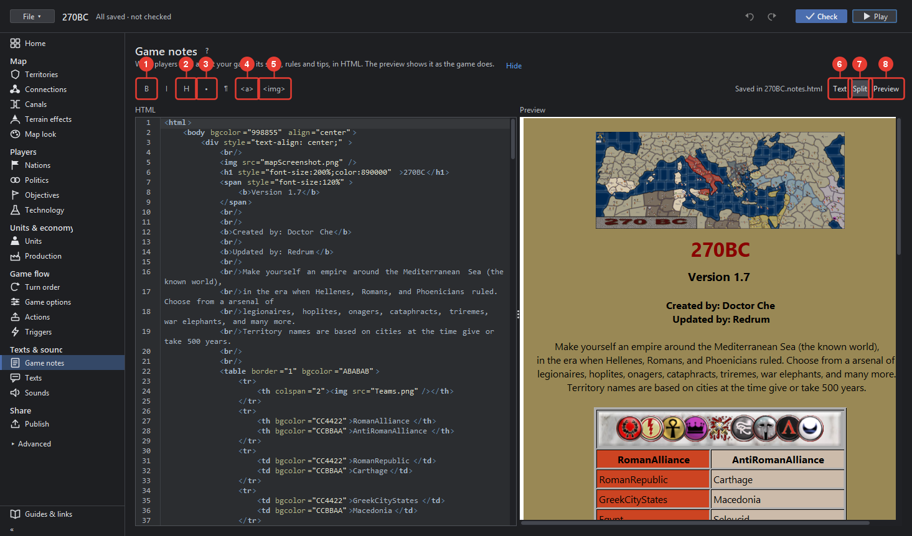

# Game notes

[← Guide](README.md)

What players read about your game: its story, rules and tips, in HTML. The preview shows it as
the game does. The notes are saved in the game's notes file beside the game, for example
270BC.notes.html, which the line at the right names.

1. **B** bold (Ctrl+B) and **I** italic (Ctrl+I) wrap the chosen text.
2. **H** makes a heading of the line.
3. **•** makes a list item of the line.
4. **¶** a line break (Shift+Enter).
5. **Link…** asks for the address and the words.
6. **Picture…** chooses a picture file; it is copied into doc/images beside the notes and
   linked from there, so the map carries it.
7. **Text** shows the HTML alone, wide.
8. **Split** shows the HTML on the left and the preview on the right.
9. **Preview** shows the notes as the game shows them, alone.

The HTML side is a text editor with colouring, line numbers, folding and find (Ctrl+F); the
text size and the theme follow the editor. Notes that are not UTF-8 open as TripleA shows them
and are saved only when changed.
