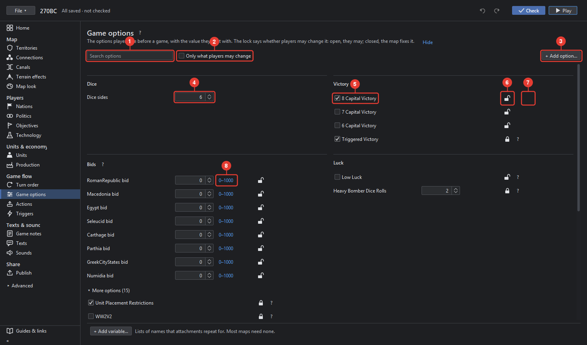

# Game options

[← Guide](README.md)

The options players see before a game, with the value they start with. The lock says whether
players may change it: open, they may; closed, the map fixes it. The options are grouped: Dice,
Victory, Bids, Luck, and More options for the rest.

1. **Search options** finds an option by its name.
2. **Only what players may change** hides the fixed ones.
3. **+ Add option…** adds an option TripleA knows, for example Low Luck, or one the map's
   triggers read.
4. A number option, here **Dice sides**, has a field.
5. A yes/no option, here **8 Capital Victory**, has a box.
6. **The lock** beside each option: open, players may change it before a game; closed, fixed by
   the map. Click to switch.
7. **Remove option from the game**: the game then uses TripleA's default for it.
8. **Range**, for a number players may set: the least and the most, here 0 to 1000 for a bid.

Every option a "?" beside it explains, in TripleA's words. **Bids** are one per nation: PUs a
player may bid to play that nation. **Use Triggers** must be on for any trigger to fire; the
Triggers tool says so when it is off.
