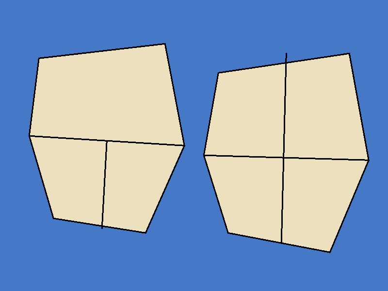
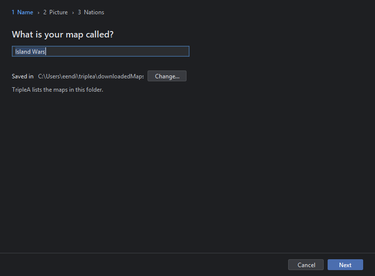
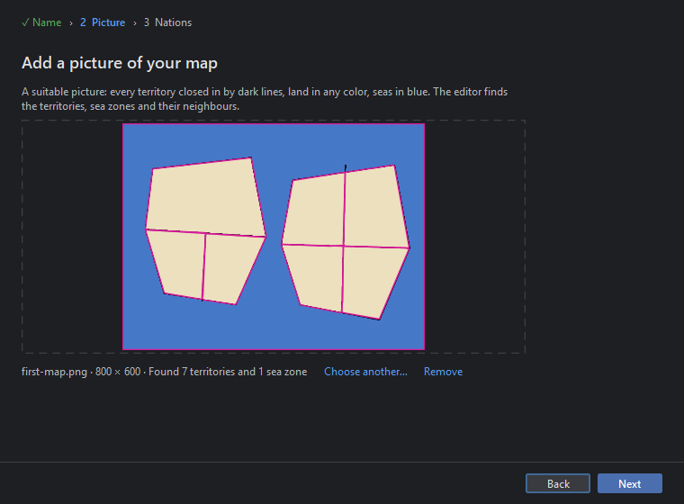
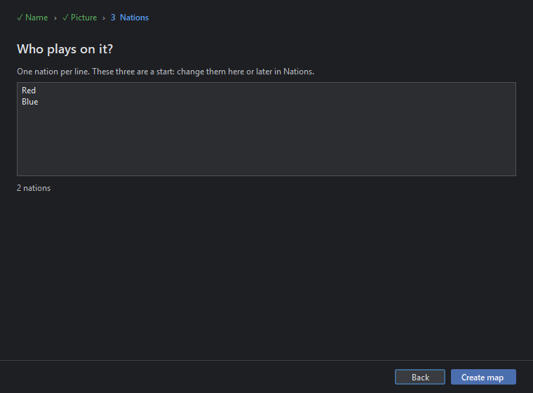

# Getting started: your first map

[← Guide](README.md)

A small map from a picture to a game you can play, in about twenty minutes. The picture below
is the example: two islands, each cut into three territories, in a sea. Save it to your
computer to follow along, or draw one like it in any paint program.

What a map picture needs: every territory closed in by dark lines, land in any colour, seas in
blue. Black lines three pixels wide work well; thin grey lines are read too. Names, flags and
numbers are not drawn into the picture, the game draws them itself.

## 1. Make the map

Start the editor and choose **New map** on the start page, or File → New map… (Ctrl+N).

Type a name, here "Island Wars". It becomes the game's name and the folder's name, in small
letters with underscores, inside TripleA's maps folder, which **Saved in** shows. Click **Next**.

Drop the picture on the frame or click **Choose picture…**. The editor reads it and looks for the
territories at once; the line at the bottom says "Reading … and finding its territories" with a
bar, then what it found: here 800 × 600, 7 territories and 1 sea zone. If the count surprises
you, a border is not closed or not dark enough: fix the picture and choose it again. Click
**Next**.

One nation per line: "Red" and "Blue". Each gets a colour, a flag and the unit pictures of a
standard nation tinted in its colour, so the map plays at once. Click **Create map**. The map is
written as a folder with map.yml, the game, the outlines, the picture cut into tiles, the flags
and the unit pictures; the editor opens it on Home.

## 2. Follow Home's guide

Home says what was found and lists **Steps to a playable map**, each with the tool that does it.
The first step, making the territories from the picture, is done. Click a step: its tool opens
with the step as a goal in the row above the map, and the tool is set up for it.

### Give every nation its land

The step opens Territories with the Paint brush set to Red's colour. Click or drag across the
west island's three territories: they turn red. Now pick Blue in the row above the map, or in
Paint → Owner, and paint the east island. The sea zone stays without owner. Finish with
**Done** in the row above the map, or go on with the next step on Home.

### Mark each nation's capital

The brush is now Paint → Capital. Click one territory of Red and one of Blue. A capital flag
appears where the game will draw it. A nation without a capital cannot collect its PUs, so the
guide insists on this step.

### Give the territories a value

Choose Paint → PUs per turn → 2 and drag across all six land territories; make the two capitals
worth 3 with Paint → PUs per turn → 3. The Values view shows the numbers. A nation's income is
the sum of its land, so Red and Blue each start with 7 PUs a turn.

### Place the units each territory starts with

The step opens the first territory without units. In **Units at the start** click **+ Add units**,
pick infantry and type 2. Do that for each territory, or do one and paint the rest: Paint → Units
→ Copy units of the chosen one, then drag across the others; the units turn to each territory's
owner. The sea zone gets nothing. Where the game draws them is a place; drag a unit place with
Places → Units if it sits badly.

### Check which territories border each other

The step opens Connections. The wizard found the neighbours from the picture: every territory
touches the sea zone, and the three of each island touch each other. Click a territory to see
its lines in red; click a neighbour to connect or part. Nothing should be missing here, but
**Find neighbours again…** says so when it is.

## 3. Check and play

Click **Check (F6)**. The editor loads the map as TripleA does and plays the first round in
memory. With the steps above done it finds no problems; otherwise the list names each one with
the tool that fixes it, for example a nation without a capital or a territory without a
connection.

Click **Play (F7)**. The map is saved, the check runs on the saved files, and TripleA starts with
your map in its game chooser: Island Wars, Red against Blue, two turns of buying infantry and
moving across the sea once you add a transport.

## 4. The usual next things

- **Units.** The map starts with TripleA's standard unit types. In [Units](units.md) remove what
  the map does not need and change the numbers; in [Production](production.md) set what each
  nation may buy and for how much.
- **A transport.** Red and Blue cannot reach each other without one: give both a transport in a
  sea zone with Nations → Units it holds at the start, or a factory in the capital and a rule
  that sells transports.
- **Names on the map.** [Map look](map-look.md) → Territory names draws them; the places are
  made by the wizard and moved with Places → Names in Territories.
- **A relief.** [Map look](map-look.md) → Create relief… makes coasts and raised land from the
  outlines, so the flat picture looks like a map.
- **Notes.** [Game notes](game-notes.md) is what players read before they start.
- **Publish.** [Publish](publish.md) lists what the map still needs to be downloadable in TripleA
  and the steps to upload it.

Every change is a step: Undo (Ctrl+Z) takes it back, Save (Ctrl+S) writes it, and the first
version of each file stays as `.bak` in the folder.
