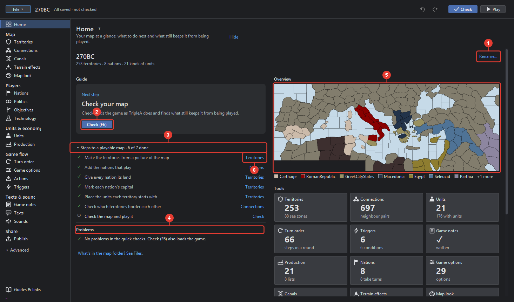

# Home

[← Guide](README.md)

Your map at a glance: what to do next and what still keeps it from being played. The editor
opens a map here.

1. **Rename…** renames the map: the game's name and the entries in map.yml. See
   [Rename map](menus.md#file-menu). The line below the name counts the territories, nations and
   kinds of units.
2. **Next step.** The guide's card names the one step that comes next, with a button that opens
   its tool or runs it, here Check (F6). After a clean Check the card suggests what to improve.
3. **Steps to a playable map** folds the full list: a ✓ for each step done, ○ for the rest, and
   the tool that does it at the right. Click a step to open its tool with the step as a goal:
   the row above the map says what to do, and the tool is set up for it, for example the Paint
   brush with the next nation's colour.
4. **Problems** lists what the quick checks found, with a link into the tool that fixes each.
   "Check (F6) also loads the game" reminds that only Check finds what TripleA refuses. After a
   Check the list holds what TripleA said, with **Show all** when there are many.
5. **Overview** draws the map small in the owners' colours, with the nations' legend below;
   "+n more" lists the rest in its tool tip.
6. **Tools** are tiles, one per tool, each with a count that says what the map has there, for
   example 253 territories and 88 sea zones. Click a tile to open the tool.

Below the tools, **Check now** runs Check, and **What's in the map folder? See Files.** opens
the Files tool.
