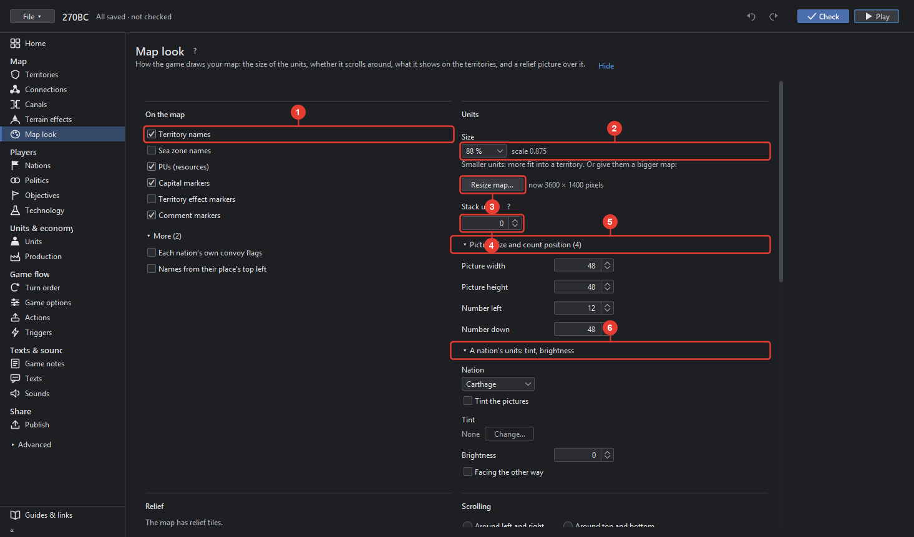
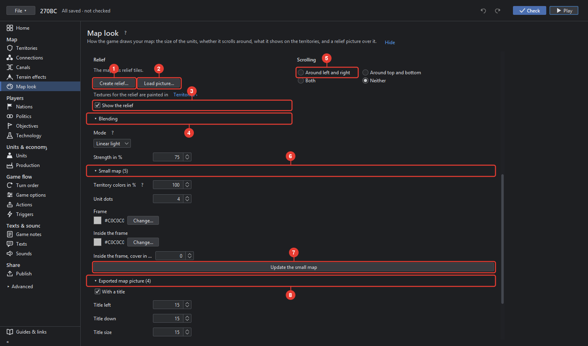
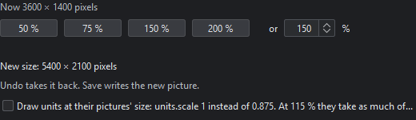

# Map look

[← Guide](README.md)

How the game draws your map: the size of the units, whether it scrolls around, what it shows on
the territories, and a relief picture over it. Everything here goes into map.properties.

1. **On the map**: what the game draws on every territory. **Territory names**, **Sea zone
   names**, **PUs (resources)**, **Capital markers**, **Territory effect markers**, **Comment
   markers**. Under More: **Each nation's own convoy flags**, and **Names from their place's top
   left** for maps whose name places mark the top left corner instead of the middle.
2. **Units → Size**: how big the game draws units, as a fraction of their pictures, for example
   scale 0.875. Smaller units: more fit into a territory. "Or give them a bigger map" leads to
   Resize map.
3. **Resize map…** makes the whole map bigger or smaller. See [Resize map](#resize-map) below.
   The line beside it says the map's size now.
4. **Stack up to**: how many units of a kind are drawn on top of each other; 0 for one with a
   number.
5. **Picture size and count position**: **Picture width** and **height** of the unit pictures in
   pixels, 48 for the game's own; **Number left** and **Number down**, where the count is drawn
   from the picture's corner.
6. **A nation's units: tint, brightness**: pick the **Nation**; **Tint the pictures** in a colour
   chosen with **Change…**; **Brightness** from −100, dark, to 100, light; **Facing the other
   way** mirrors the pictures.

1. **Create relief…** makes a relief from the outlines: coasts, waves and raised land, in a look
   you choose. The relief is kept in `reliefTiles`.
2. **Load picture…** takes a picture as big as the map as the relief; saving cuts it into
   reliefTiles. "Textures for the relief are painted in Territories ›" opens Territories, where
   Paint → Textures paints them.
3. **Show the relief** is what the game does unless told not to (map.hasRelief).
4. **Blending**: **Mode** and **Strength in %**, how the relief blends over the picture.
5. **Scrolling**: whether the map goes on at the other side, **Around left and right**, **Around
   top and bottom**, **Both** or **Neither**.
6. **Small map**: the map in the corner of the game. **Territory colors in %**, **Unit dots**
   size in pixels, the **Frame** colour and the colour **Inside the frame** with **cover in %**.
7. **Update the small map** makes the small map's picture anew from the map's picture with its
   relief, written at once; the game fills the land in the owners' colours over it.
8. **Exported map picture**: what a player's File → Export map picture writes: **With a title**,
   **Title left**, **Title down**, **Title size** and **Title color**.
9. **Mouse pointer**: the map's own pointer is misc/cursor.gif; **Point left** and **Point down**
   are the point of it that clicks.

## Resize map

From Map look or the map picture menu.

- **Now** shows the size.
- **50 %, 75 %, 150 %, 200 %** are the usual sizes; **or** a value from 25 to 400 % typed in the
  field. **New size** says the result in pixels. A size that cannot be done says why and keeps
  Resize map off.
- **Draw units at their pictures' size** appears for a map whose units.scale is not 1: ticked,
  the resize sets units.scale to 1 and the suggested size keeps the units as big on the map as
  they are now.
- **Resize map** does it. The picture, the borders and every place are resized with it; units
  keep their size, so a bigger map gives them more room. Undo takes it back.

What happens:

- A saved map is resized tile by tile from its tiles on disk, never holding the whole picture,
  so any size works. A progress bar above the map and a spinner beside the button show it
  working; a big map takes a few minutes. The new tiles show at once; a save moves them into the
  map's folder and keeps the old ones aside, so an undo after the save still has them.
- A picture not saved yet is held whole, up to 50 million pixels: save first for a bigger size.
- A picture with lines drawn that are not saved yet asks for a save first, so the tiles have the
  lines.
- A map enlarged by an odd factor such as 120 % looks softer than before: a painted relief cannot
  be enlarged sharply by resampling. For the sharpest result enlarge the picture in an image
  editor and load it with Load another picture, or resize in whole steps.
- The message after the save ends with the map's new size.
