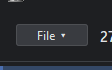
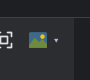
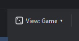
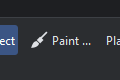
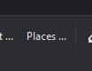
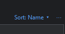

# Menus

[← Guide](README.md)

## File menu

- **Open a map… (Ctrl+O)** asks for a map folder, then for the game when the map has more than
  one. Maps are kept in TripleA's maps folder, where TripleA finds them.
- **New map… (Ctrl+N)** starts the [New map wizard](new-map.md).
- **Recent maps** lists the maps opened last.
- **New game from this one…** copies the saved game under a new name beside it, for a shorter
  or different scenario of the same map, and opens the copy.
- **Rename map…** renames the game, which is the name players choose the map and its game by,
  and the entries in map.yml that carried the old name. The folder keeps its name, which the game
  finds the map's files by. A name has at most 70 characters. Rename… beside the title on Home
  does the same.
- **Export as zip… (F8)** packs the map's folder without the `.bak` files, as the map server
  takes it; the map is saved first.
- **Publish…** opens the [Publish](publish.md) tool.
- **Play with: TripleA…** chooses the TripleA that Play starts, when more than one is installed;
  the menu names the one in use.
- **Show in Explorer** (Finder on a Mac) opens the map's folder.
- **Close map (Ctrl+W)** goes back to the start page, asking about unsaved changes first.
- **Show all options** opens every "▸ More … options" row in every tool, now and next time.
- **Version** is the editor's version. "dev" for a build from the sources.

## The map picture menu

The button at the right end of the map's toolbar.

- **Show the map picture** switches the picture under the colours on and off. Off, the map shows
  the owners' colours and the borders alone.
- **Load another picture…** replaces the picture, keeping the territories. The new picture is
  cut into tiles on the next save.
- **Redraw borders from a picture…** takes a picture with changed borders, drawn in a paint
  program, and redraws the territories from it: they keep their names, owners and units, new
  areas become territories, merged ones are joined.
- **Make territories again…** looks for territories in the whole picture again. Only a picture
  loaded here can be searched; a map opened from its folder has tiles instead.
- **Resize map…** is described under [Map look](map-look.md#resize-map).
- **Save the map's picture as a file…** writes the whole picture, without the relief, as one
  PNG, put together from the tiles. For a paint program; then Load another picture or Redraw
  borders. A map too big to hold is written row by row, at any size.
- **Save the relief as a file…** does the same for the relief.

## View

The same map in six colourings. The legend below the map explains the one shown.

- **Game** as it plays: the picture, the owners' colours and the units.
- **Owners** each territory in its owner's colour.
- **Political** each territory in its owner's alliance colour.
- **Values** what each territory gives per turn, capitals and victory cities.
- **Units** the units each territory starts with.
- **Connections** which territories are neighbours, as the Connections tool shows them.

## Paint

A brush: choose what to paint, then click or drag across territories.

- **Owner** a nation, or no owner: dragging across land gives it that owner.
- **Capital** makes the clicked territory its owner's capital.
- **PUs per turn** a value from the list, or **Other…** for any value; while painting, the
  banner above the map has a field to change it.
- **Units** copies the starting units of the chosen territory onto the territories you drag
  across, turned to their owner (**Copy units of …**, after a territory is chosen), or takes
  units away (**Clear units**).
- **Passable** paints **Impassable**, where no unit may enter, or **Passable** again.
- **Terrain effects** paints an effect from the [Terrain effects](terrain-effects.md) tool; the
  entry is grey while the game has none.
- **Textures** paints a texture from the map's textures into the relief; **Find textures in the
  map…** collects them from the picture, **Import texture…** takes a picture file. Sea textures
  are listed apart.

## Places

What the game draws on every territory, shown to drag. A right click on a place offers more.

- **Units**, **Capitals**, **Centers**, **Comments**, **Decorations**, **Names**, **PUs**,
  **Terrain effects**, **Victory cities**, **Blockades**, **Convoys**, **Kamikaze**: each ticks
  one kind of place on or off. The tool tip names the file it is kept in, for example
  place.txt for units and name_place.txt for names. "(none)" means the map has none of that kind.
- **Lay out unit places** arranges the unit places of every territory: how many at most per
  territory, and whether units beyond the places go on beside the last place.
- **Create missing places** adds a place of a kind for every territory that lacks one, for
  example names for territories without a line in name_place.txt.
- **Reload places from the files** reads place.txt, the marker files and decorations.txt again,
  for a map changed by hand or with another program while it is open.

A click in the chosen territory adds a unit place. A right click on a unit place offers **Add a
unit place here**, **Remove this unit place**, **Back to its found place**, **Put here** and
**Units overflow to the left / right**.

## Sort

The order of the territories list: by **Name**, by **Owner** or by **PUs**.

## Many territories at once

The ⋯ button beside Sort.

- **Export names…** writes the names as lines `name;` to fill in the new names.
- **Import names…** renames territories by a text or CSV file of lines `old;new`.
- **Export territory pictures…** writes a PNG of each territory chosen, to draw on in a paint
  program and lay over the map.
- **Remove territories…** ticks the territories to remove, the smallest first, for example
  islands found by mistake.
