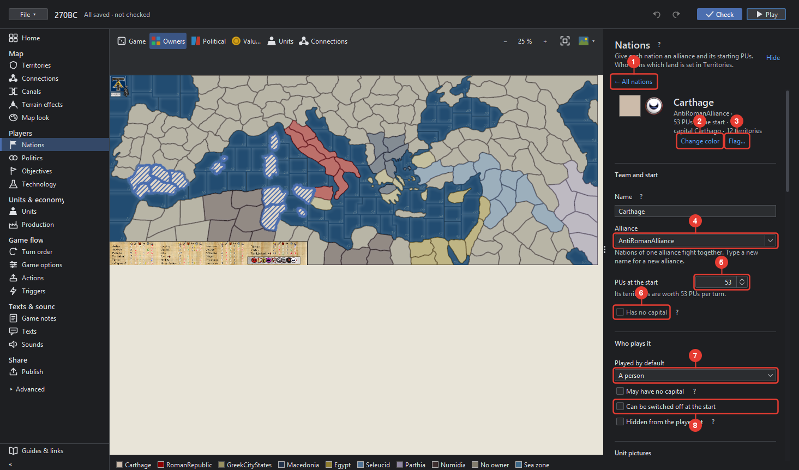
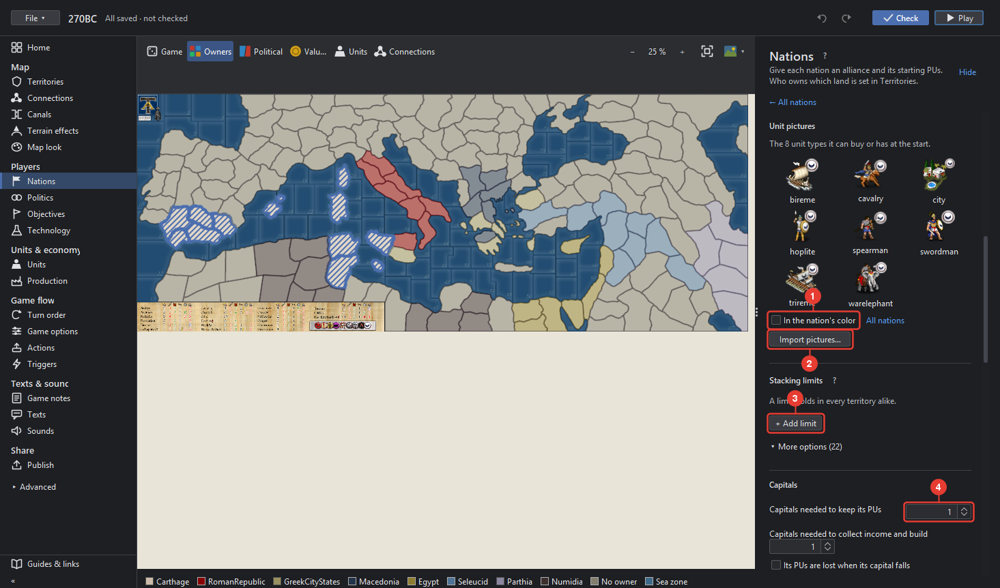
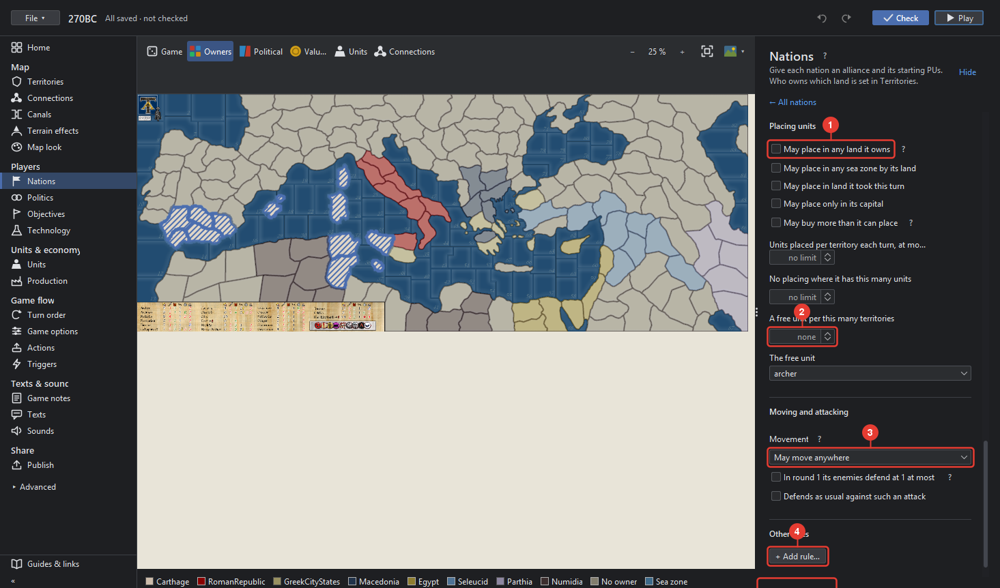

# Nations

[← Guide](README.md)

Give each nation an alliance and its starting PUs. Who owns which land is set in Territories. The
map shows the Owners view; the list on the right names the nations, each with its colour and, once
the map has a folder, its flag; a click chooses one.

1. **← All nations** goes back to the list, which has **+ Add nation…**.
2. **Change color**: the colour the game draws the nation's land and tints its units in. The
   swatch beside the flag opens the same chooser.
3. **Flag…** chooses a picture: it becomes the nation's flags in the sizes the game shows
   (flags/Name.png, _small, _large, _fade).
4. **Alliance**: nations of one alliance fight together. Type a new name for a new alliance; the
   box lists the ones there are.
5. **PUs at the start**: what the nation has to spend in its first turn. The line below says what
   its territories are worth per turn.
6. **Has no capital**: a nation that plays without one, so it keeps its PUs without it. While the
   nation has a capital the box says where: untick that in Territories first.
7. **Who plays it**: **Played by default** human or an AI, as the game proposes it.
8. **Can be switched off at the start**: players may leave the nation out. **Hidden from the
   player list** hides a nation that only holds neutral land. **May have no capital** lets it
   start without one.

The header shows the flag, the alliance, the PUs, the capital and the number of territories.
**Name** renames the nation: the game and every file that carries the name follow on the next
save, the flags and unit pictures included.

1. **Unit pictures**: the unit types the nation can buy or has at the start, each with its
   picture as the game shows it. **In the nation's color** tints the pictures when the game draws
   them; the files stay. **All nations** does that for every nation.
2. **Import pictures…** takes a folder of pictures named like unit types for this nation.
3. **Stacking limits**: at most so many units of some types together in one territory, when
   placing, moving in or attacking, counting the nation's own, its allies' or everyone's.
   **+ Add limit** chooses the unit types. Limits written once for every nation of a variable
   show as sentences with a link to Attachments, where they are changed.
4. **Capitals**: **Capitals needed to keep its PUs** and **to collect income and build**; **Its
   PUs are lost when its capital falls**; **Immune to blockades**.
5. **Sharing**: **Hands its units over to** another nation, also **in all territories, not only
   theirs**; **Shares its technology with**; **Helps pay its research**.
6. **Units it holds at the start**: units the nation holds without a territory, for example a
   fleet at sea; **+ Add unit…**.

1. **Placing units**: **May place in any land it owns**; **in any sea zone by its land**; **in
   land it took this turn**; **only in its capital**; **May buy more than it can place**; **Units
   placed per territory each turn, at most**; **No placing where it has this many units**.
2. **A free unit per this many territories** and **The free unit**: a unit the nation gets for
   every so many territories it owns.
3. **Moving and attacking**: **Movement** how the nation's units move; **In round 1 its enemies
   defend at 1 at most**, a surprise attack; **Defends as usual against such an attack**.
4. **Other rules**: **+ Add rule…** adds any rule of the game's playerAttachment the sections do
   not show, by its name in the game's XML; each has a field and ×.
5. **Remove nation** takes the nation out of the game. Its land becomes unowned, its units go.
