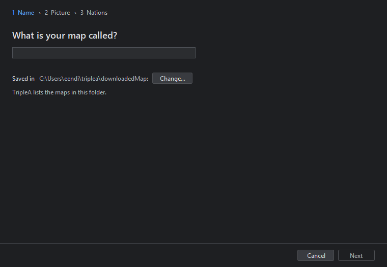

# New map

[← Guide](README.md)

File → New map… (Ctrl+N), or New map on the start page. The wizard makes a map from a picture in
three steps and saves it in TripleA's maps folder, where TripleA finds it.

## 1 Name

- **What is your map called?** The name players see. It becomes the folder's name too, in small
  letters with underscores, and the game's name. Rename map changes the game's name later; the
  folder keeps its name.
- **Saved in** shows TripleA's maps folder. **Change…** picks another folder; TripleA lists the
  maps in the folder it is told.
- **Next** goes on once the name is typed; **Cancel** leaves without a map.

## 2 Picture

- **Choose the picture of your map** opens the system's file dialog for a PNG, JPEG, GIF or BMP.
  The editor reads it and looks for territories at once: areas of one colour between dark lines
  become territories, the blue ones sea zones. A big picture takes a moment; the status line and
  a bar say so, and Next waits for it.
- A preview shows the territories found, each with its outline. If the count is wrong, the
  picture's borders are not closed or not dark enough: fix the picture and choose it again.
- A map without a picture is possible too: skip this step and draw the borders later with Draw
  borders in Territories.

## 3 Nations

- **Nations** one per line. Each gets a colour, a flag and the unit pictures of a standard
  nation, tinted in its colour, so the map plays at once.
- **Create** writes the map: its folder with map.yml, the game, the outlines, the picture cut
  into tiles, flags and unit pictures. A bar shows it working; a map is written whole or not at
  all. Then the map opens on Home, which says what was found and what to do next.

## After the wizard

Home's guide lists the steps to a playable map: give every nation its land, mark the capitals,
place starting units, check the connections, then Check and Play. Each step opens its tool with
the step as the goal above the map.
