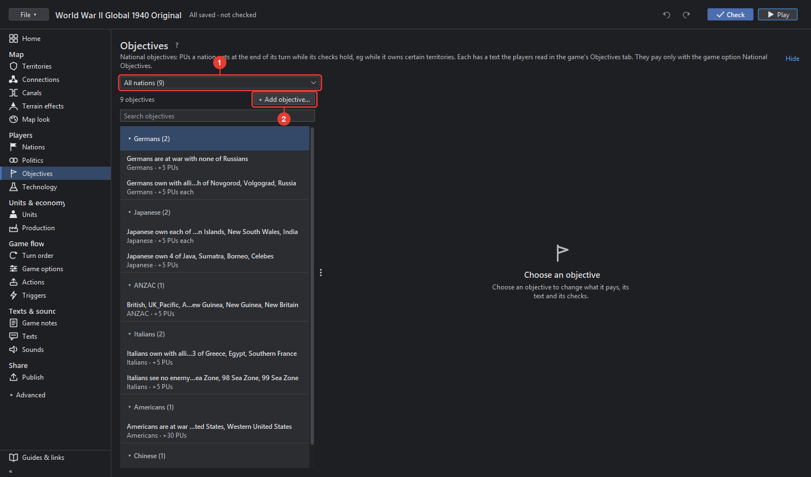

# Objectives

[← Guide](README.md)

National objectives: PUs a nation gets at the end of its turn while its checks hold, for example
while it owns certain territories. Each has a text the players read in the game's objectives tab.
The picture shows WW2 Global 1940.

1. **Objectives of which nation** filters the list to one nation; "All" lists every objective.
2. **+ Add objective…** makes one: pick the nation, then its checks.

An objective, once chosen in the list:

- **Nation** whose objective it is and who gets the PUs.
- **Reward**: **PUs each round** while the checks hold. **Give it to other nations instead**
  pays another nation.
- **How often**: **Every round**, or **Only in the first** so many rounds; a count of uses.
- **Counts the land and units of** the nation itself, or others; "None: of its own nation."
- The checks: territories the nation must own, units it must have, and so on, each a line with
  **Choose…** for the territories or unit types; **+ Add a check** adds one. **Also needs the
  conditions** lists conditions of the map the objective needs too.
- **Text the players read**, kept in the objectives text file by the objective's key; the
  [Texts](texts.md) tool edits the same.
- **Duplicate** makes a copy with the same checks and text. **Remove objective** takes it out.
- Options the editor has no words for stay as they are: "Kept as they are. Change them in
  Attachments."

**Turn on** appears while the game option National Objectives is off: without it the game pays
no objective. It turns the option on in Game options.
