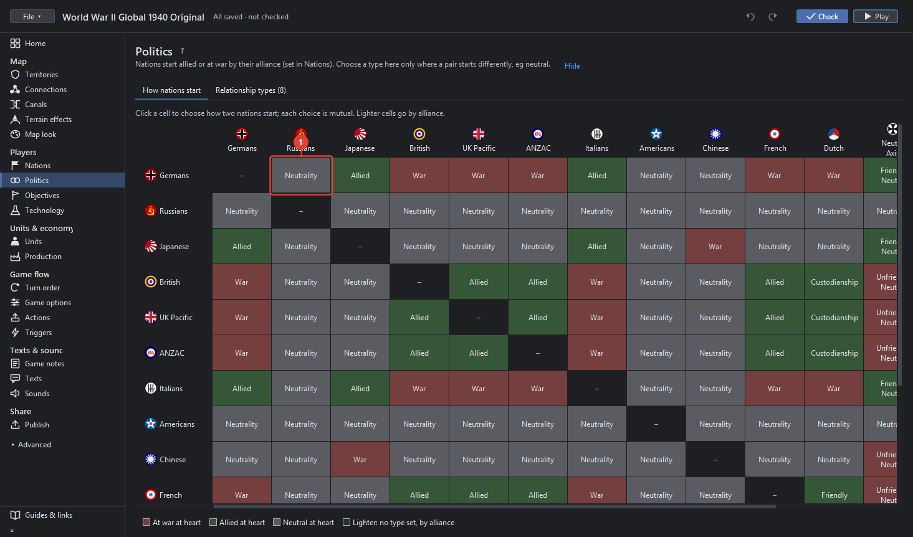

# Politics

[← Guide](README.md)

Nations start allied or at war by their alliance, set in Nations. Choose a type here only where a
pair starts differently, for example neutral. The picture shows WW2 Global 1940, which uses
several kinds of neutrality.

1. **How nations start** is a grid with a cell per pair of nations, each nation's flag before its
   row's name and above its column's. Click a cell to choose how the
   two start; each choice is mutual, so the mirrored cell follows. Lighter cells go by alliance:
   Allied within one alliance, War between alliances, nothing chosen by hand. A cell with a
   type chosen by hand is drawn darker. The tool tip of a cell says "Germans and Russians start
   as Neutrality".

The second tab lists the **relationship types** the game has, each with **What nations in it may
do in each other's land**: move through, fight, land planes, and whether the type counts as
allied, neutral or at war. Add a type for a map that needs more than Allied, Neutral and War.

A political action in [Actions](actions.md) changes a pair's type during the game; a trigger can
do the same.
