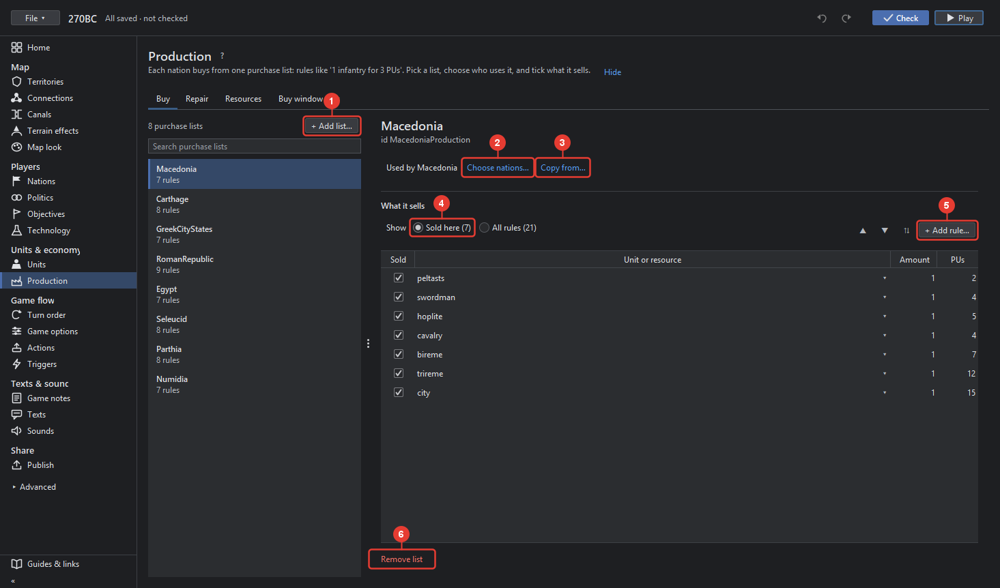

# Production

[← Guide](README.md)

Each nation buys from one purchase list: rules like "1 infantry for 3 PUs". Pick a list, choose
who uses it, and tick what it sells. Four tabs: **Buy**, **Repair**, **Resources** and **Buy
window tabs**.

1. **+ Add list…** adds a purchase list; a nation without one cannot buy. The list on the left
   names the lists; a click chooses one. The header shows its id in the game file.
2. **Used by … Choose nations…**: the nations that buy from this list. A nation uses one list.
3. **Copy from…** takes the rules of another list in place of this one's.
4. **Show**: **Sold here (n)** lists the rules this list sells; **All rules (n)** every rule of
   the game, with a tick for each that this list sells. A rule is a unit or resource for a price;
   tick it to sell it here.
5. **+ Add rule…** makes a rule: the unit or resource, how many, and what it costs in each
   resource. A rule with a count sells several at once, for example 2 infantry for 7 PUs. Each
   rule row has **Rename**, **Remove rule** and, in the row, the price fields. **▲ ▼** move the
   chosen rule, which is the order of the game's buy window, with Sold here shown; **⇅** orders
   the whole list in one step: A to Z, by cost or by kind as TripleA's own buy tabs group units
   (land, air, sea, construction, upgrades, resources), and with several lists, every list at
   once. Undo takes an order back.
6. **Remove list** takes the list away; its nations then have none.

## Repair

Repair lists work like purchase lists: which damaged units a nation may repair and what one point
of repair costs. **Choose nations…** says who uses the list.

## Resources

The game's resources, PUs first; **Add resource…** adds another, for example Ore, with its icon
(**Change icon…**) and what each nation has of it **At the start**. Territories give resources per
turn in Territories → More options, units in Units → Production and infrastructure.

## Buy window tabs

The tabs of the game's purchase window. **TripleA's own tabs** sort units by kind; **Own tabs**
lets the map define the tabs: each a name and the unit types in it.
