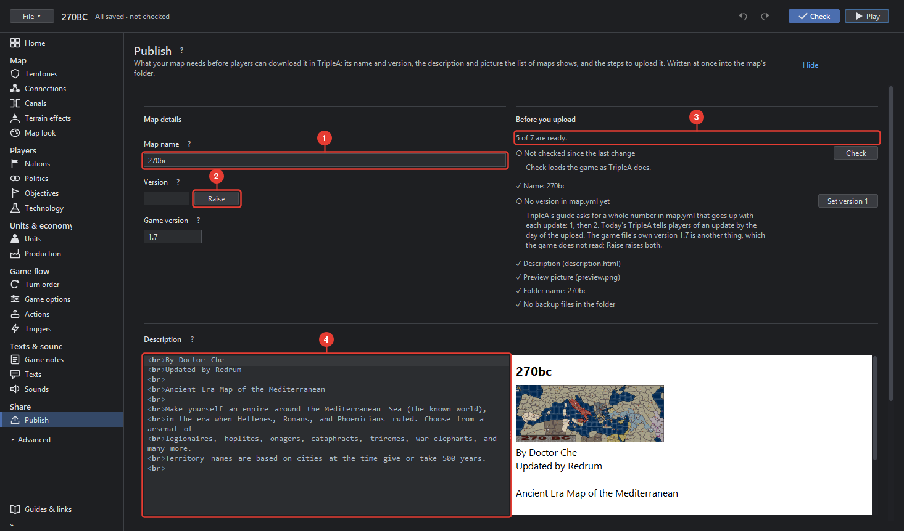
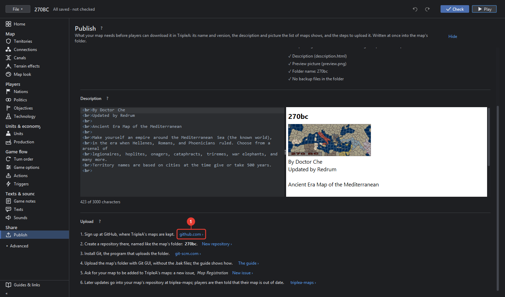

# Publish

[← Guide](README.md)

What your map needs before players can download it in TripleA: its name and version in map.yml,
the description and picture the list of maps shows, and the steps to upload it.

1. **Map name**: the name in TripleA's list of maps to download (map.yml map_name), at most 70
   characters. The games in the map have names of their own; Rename map changes the game's.
2. **Version**: a whole number in map.yml, raised with each update you upload; **Raise** makes
   it one higher. **Game version** below it is the game file's own (info version), free text as
   0.021, which TripleA's upload guide recommends changing with the game notes though the game
   does not read it; Raise raises its last number too. A line says when the game file names a
   TripleA version it needs, which TripleA no longer reads.
3. **Before you upload**: the checklist, "n of m are ready": checked since the last change, a
   name, a version, the description, the preview picture, the folder's name as the upload guide
   asks it, no backup files in the folder. Each ○ has a button that does it, for example **Set
   version 1** or **Check**.
4. **Description**: what the list of maps shows about the map (description.html), with a preview
   as TripleA shows it and the count of characters, 3000 at most.

1. **Upload**: the steps to publish, each with a link. Sign up at GitHub, create a repository
   named like the map's folder, install Git, upload the folder with Git GUI as the guide shows,
   ask for the map to be added with a Map Registration issue, and
   later updates go into the map's repository at triplea-maps, after which players are told
   their map is out of date.

**Export as zip…** in the File menu packs the folder for an upload by hand, without the `.bak`
files an older version of the editor left there.
