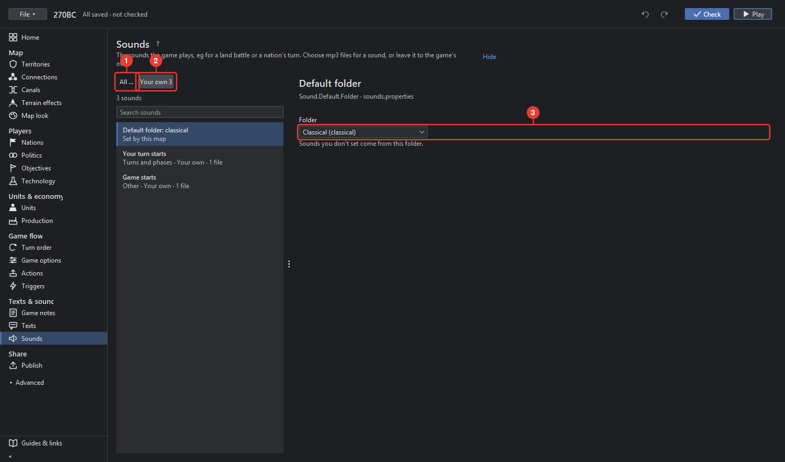

# Sounds

[← Guide](README.md)

The sounds the game plays, for example for a land battle or a nation's turn. Choose mp3 files for
a sound, or leave it to the game's own. The settings go into sounds.properties.

1. **All** lists every sound the game knows, with its key.
2. **Your own** lists only the sounds this map sets.
3. **Default folder**: the folder the sounds you do not set come from (Sound.Default.Folder).

A sound, once chosen in the list, has:

- **Plays**: when the game plays it, in plain words, and **For** which nation when the sound is
  per nation.
- **Folder** or files: **Add file…** adds an mp3, **Add folder…** a folder of them, from which
  the game picks one at random; × takes one away; **Files as text** shows the line as the file
  has it.
- **▶** and **■** play and stop the sound here.
- **Use the game's own sound** takes the map's setting away.
