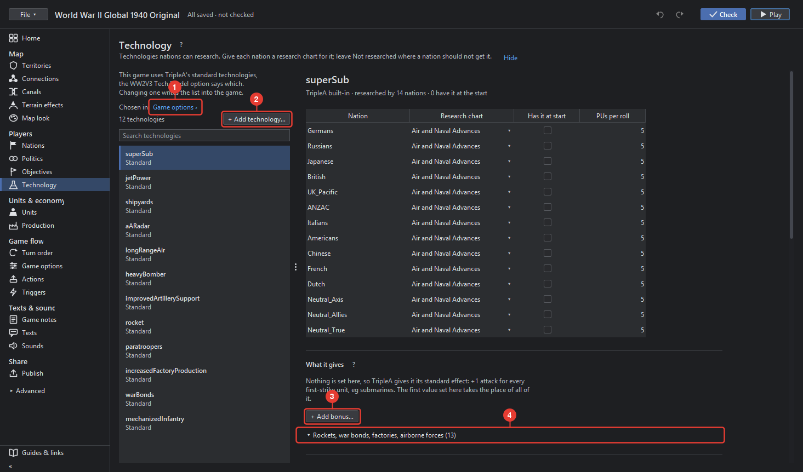

# Technology

[← Guide](README.md)

Technologies nations can research. Give each nation a research chart for it; leave Not researched
where a nation should not get it. The picture shows WW2 Global 1940 with the technology superSub
chosen.

1. **Chosen in Game options ›**: which technology model the game uses is the option WW2V3 Tech
   Model. A game that uses TripleA's standard technologies says so above the list; changing one
   writes the list into the game.
2. **+ Add technology…** adds one of the game's own, or a new one with its own bonuses.
3. **What it gives**: the bonuses, each a number for a unit type, for example +1 attack for
   fighters; **+ Add bonus…** adds one. A standard technology with nothing set here keeps its
   standard effect, which the text names.
4. **Rockets, war bonds, factories, airborne forces**: the rarer settings. **Rockets reach this
   many territories**, **Rocket attacks from one territory, at most**; **Dice rolled for PUs each
   turn** and **Sides of each die** for war bonds; **More units produced only in territories
   worth at least** and **Repairs cost less, in %** for factories; **May blitz** and **May
   bombard** give units the ability; airborne forces: **Units can drop from a base as airborne
   forces**, **Airborne units reach this many territories**, **Units that can drop**, **Bases they
   start from**, **+ Add anti-air kind…** for the anti-air that shoots at them.
5. **Remove technology** takes it out of the game.

Above the bonuses the header says which nations research it and how many have it at the start.
Each nation's research chart, the set of technologies it may get, is set per nation in the list
of nations at the left; "Not researched" leaves a technology out of a nation's chart.
