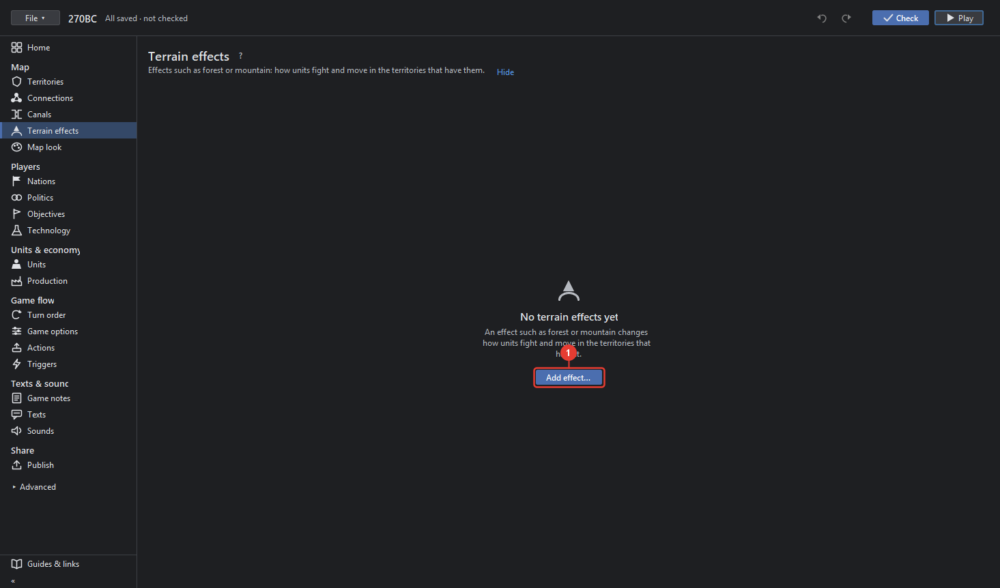

# Terrain effects

[← Guide](README.md)

Effects such as forest or mountain: how units fight and move in the territories that have them.

1. **Add effect…** makes an effect: give it a name. A map without effects shows this alone.

An effect, once chosen in the list on the left, has:

- **Name** as the game file names it; a marker picture of that name in the map's
  `territoryEffects` folder is drawn on the territories that have the effect. "No picture in the
  map's folder" says there is none yet; "Save the map first: the picture goes into its folder"
  while the map is new.
- **In battle and on the move**: what the effect does to units, each line a unit type with its
  change, for example attack −1 or movement cost 2. **Choose…** picks the unit types; × takes a
  line away.
- **Who may enter**: unit types the effect keeps out, for example tanks out of a swamp.
- **Show on map** switches to Territories with the effect as the Paint brush, where a click gives
  a territory the effect. Paint → Terrain effects in Territories does the same.
- **Remove effect** takes it out of the game and off every territory.
