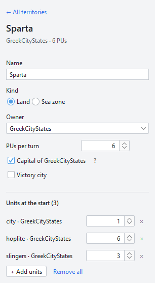
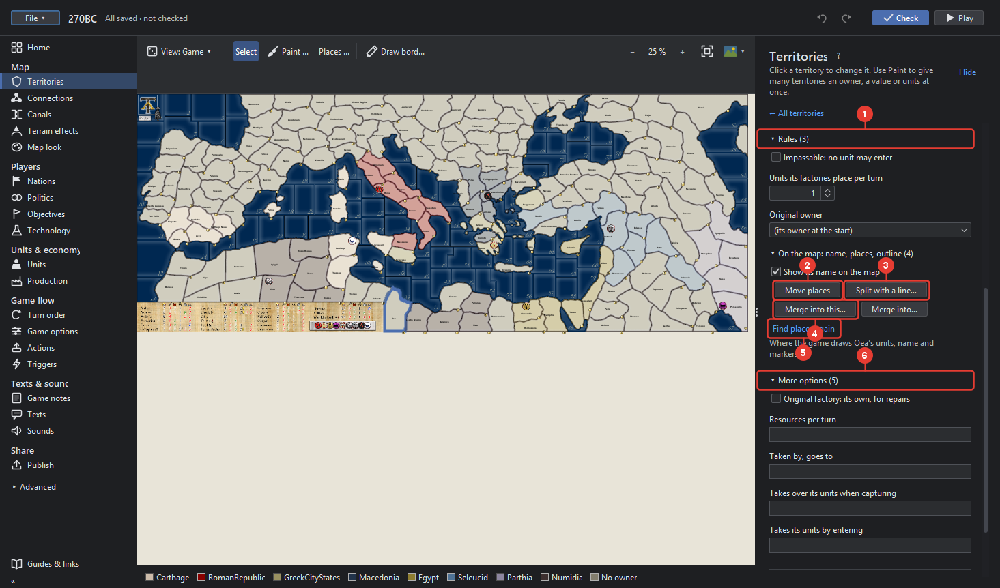
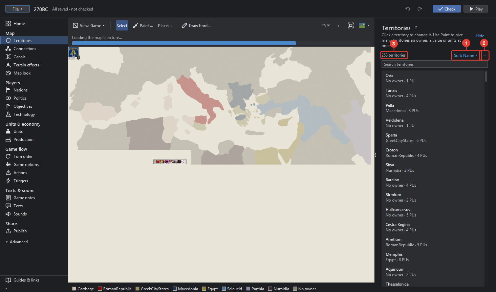

# Territories

[← Guide](README.md)

Click a territory to change it. Use Paint to give many territories an owner, a value or units at
once. The tool shows the map with its toolbar, the list of territories on the right, and the
chosen territory in place of the list.

## The map and its toolbar

1. **View** switches the colouring: Game, Owners, Political, Values, Units, Connections. See
   [View](menus.md#view).
2. **Select** is the usual mode: a click on the map chooses the territory.
3. **Paint** opens the brush menu: owner, capital, PUs, units, passable, terrain effects,
   textures. While a brush is chosen, a click or drag paints; the row above the map says what is
   painted and has a field for the value. See [Paint](menus.md#paint).
4. **Places** shows where the game draws units, names, flags and markers on every territory, to
   drag; lays out unit places; creates missing ones. See [Places](menus.md#places).
5. **Draw borders** draws dark lines into the map's picture; Erase takes lines out. The relief is
   hidden meanwhile. Then **Make territories** finds the territories between the lines, keeping
   names, owners and units where a territory stays. Lines drawn are kept with the map until a
   save writes the tiles they touched.
6. **−**, the zoom in percent, **+**: zoom out and in; Ctrl+wheel does the same, a click on the
   percent goes to 100 %.
7. **Fit the map (Ctrl+0)** shows the whole map.
8. **Map picture** menu: show or hide the picture, load another, redraw borders from a picture,
   make territories again, resize, save the picture or the relief as a file. See
   [The map picture menu](menus.md#the-map-picture-menu).
9. **← All territories** goes back to the list.
10. **Owner** the nation that owns it at the start, or No owner.
11. **PUs per turn** what the territory gives its owner each turn to buy units with.
12. **Capital of its owner** ticks the territory as the capital; a nation has one. **Victory
    city** below marks it for a victory condition.
13. **Units at the start**: each kind with its count, × removes it; **+ Add units** adds a kind,
    **Remove all** takes every unit away. 0 in a count removes that kind.

Above the owner: **Name**, typed and taken on Enter; a name in use is refused. **Kind**: Land or
Sea zone.

The legend under the map names the nations' colours; **+n nations** opens the rest. Under the
Game view a hatched sea zone is one no unit may enter.

## The rest of a territory

1. **Rules**: **Impassable: no unit may enter**; **Units its factories place per turn**, as many
   as its PUs unless set here; **Original owner**, who gets it back when an ally frees it, if not
   its owner at the start.
2. **On the map: name, places, outline.** **Show its name on the map**, off where the picture
   has the name already. **Move places** switches the Places mode on for this territory.
3. **Split with a line…** draws a line across the territory and makes two of it; the new one is
   named in a dialog.
4. **Merge into this…** then click each territory that belongs to it, for example the islands
   of a group; **Merge into…** makes this territory part of another you choose.
5. **Find places again** finds the places inside the territory's border again, for example
   after its outline changed.
6. **More options**: **Original factory: its own, for repairs**; **Resources per turn** besides
   PUs, for example 2:Ore; **Taken by, goes to** pairs captor:receiver, so a territory taken by
   the first goes to the second; **Takes over its units when capturing** and **Takes its units by
   entering** list nations, as the game's whenCapturedByGoesTo, changeUnitOwners and
   captureUnitOnEnteringBy.
7. **Neighbours** lists the connected territories as buttons, each a click away; **→ Edit in
   Connections** opens the Connections tool on this territory.
8. **Remove territory** takes it out of the game, its outline and its places with it. Undo brings
   it back.

## The list

1. **Sort** orders the list by Name, Owner or PUs. See [Sort](menus.md#sort).
2. **⋯ Many territories at once**: export and import names, export territory pictures, remove
   territories. See [Many territories at once](menus.md#many-territories-at-once).
3. The count, and the search field below it: type a part of a name. Each row names the territory
   with its owner and PUs; a click chooses it.

## Draw borders, step by step

1. Choose Draw borders. The relief is hidden so the lines show. Pick the line's width and colour
   in the row above the map; "Like its lines" takes the colour most of the picture's lines have.
2. Draw across the picture. A line joins existing borders where it ends near them. Erase takes a
   line away where you drag.
3. Choose Make territories. The territories enclosed by the new lines are found; the rest stay
   as they were. New territories are named by number; rename them in the list.
4. Save. Only the tiles the lines touched are written, their first version kept in Backups.
