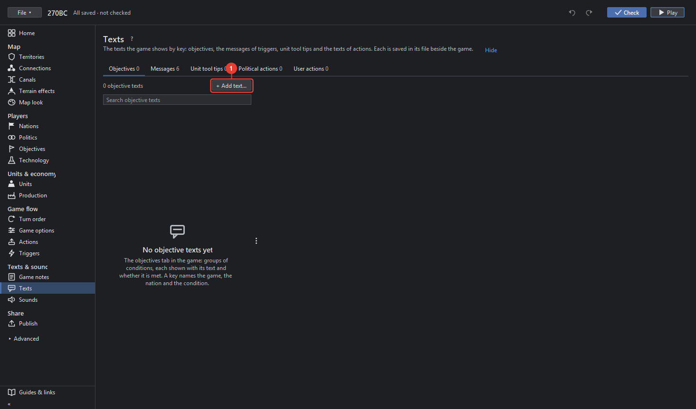

# Texts

[← Guide](README.md)

The texts the game shows by key: objectives, the messages of triggers, unit tool tips and the
texts of actions. Each is saved in its file beside the game: objectives.properties,
notifications.properties, tooltips.properties and politicstext.properties. A tab per file, each
with its count.

1. **+ Add text…** adds a text to the tab's file with a new key.

Each text has:

- **Key**: how the game finds the text. For an objective the key names the game, the nation and
  the condition; for a trigger's notification its name; for a tool tip the unit type; for an
  action its text key with .BUTTON, .DESCRIPTION and so on.
- **Text**: what the players read; HTML is allowed where the game shows HTML.
- **Preview** as the game shows it.
- **In this group (n)**: the texts that share a key's start, for example one action's texts.
- **Use them for this game** appears when the texts are in a file of another game of the map:
  it copies them for this one.
- **Remove text** takes it out of the file.

The [Objectives](objectives.md), [Triggers](triggers.md) and [Actions](actions.md) tools edit the
same texts where they belong; this tool shows them all at once, also texts no tool names.
