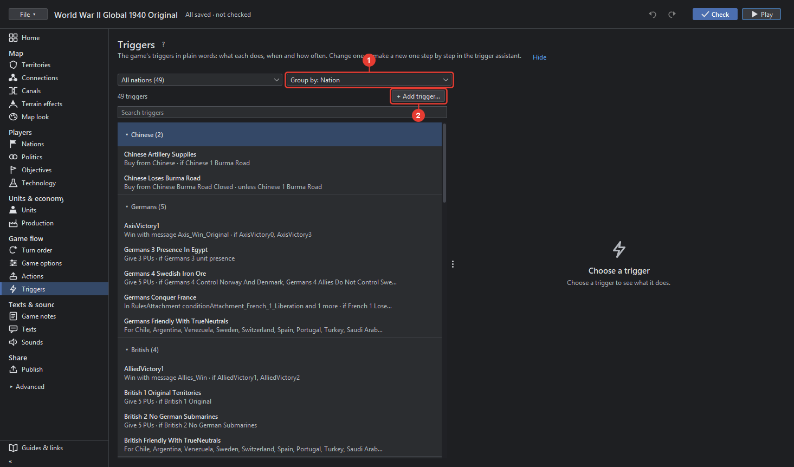

# Triggers

[← Guide](README.md)

The game's triggers in plain words: what each does, when and how often. Change one or make a new
one step by step in the trigger assistant. The picture shows WW2 Global 1940, which has 49.

1. **Group the triggers by** lists them under headings that fold: by nation, by what they do, or
   by when they fire. The list counts the triggers and shows each as one line.
2. **+ Add trigger…** opens the assistant with a new trigger.

A trigger, once chosen, reads as sentences: what it does, when it fires, how often, and the
conditions it needs, each condition a sentence of its own. Below them:

- **Change...** opens the trigger in the assistant.
- **Show** chooses a trigger the sentences name, for example one this trigger activates.
- **Duplicate** makes a copy that uses the same conditions.
- **Remove trigger** takes it out of the game.
- "Use Triggers is off: no trigger fires. Set in Game options" shows while that option is off.

## The trigger assistant

The assistant builds a trigger from an example and three questions.

1. **Start from an example** or an empty trigger. The examples are grouped: Money & units
   (Give PUs when a nation holds territories, Place units when a nation holds territories), Land
   & politics (Change relationships, declare war, in a round), Production & tech, Messages &
   victory. An example fills the steps with a working trigger to change.
2. **What it does**: the effects, one or more. **Add effect** adds something the trigger does:
   give PUs or resources, place or change units, change a relationship, activate another trigger,
   show a message, give a technology, change a game option, end the game, and more. Each effect
   has its own fields, for example the nation, the territories and the units.
3. **When**: **At each effect's usual moment**, or **Before or after the step** of a nation, for
   example before Germans' purchase. **Every round**, **In 1 round**, or **In several rounds**;
   **In how many rounds the trigger may fire; 0 is used up**. **Only by chance** adds a dice roll.
4. **Conditions**: what must be true. **Add a check** adds something a new condition checks:
   a nation holds territories, has units, the round number, a game option, and so on. **Another
   condition** adds one the map has already. **How many conditions must hold** for the trigger
   to fire, or the fewest. **Fire when the conditions are not met** turns the sense around.
5. **For nations (optional)**: the nations the trigger belongs to. Here and in every list of
   territories, nations or units, Choose ends with the game's variables of that kind, `$Axis$`
   say, under Variables.
6. **Check and save**: the assistant lists what is missing, for example "Condition c: Owns
   territories: Territories is missing.", or "No problems.", then **Add trigger** writes it.
   Options the assistant does not change stay as they are; Attachments shows them.
