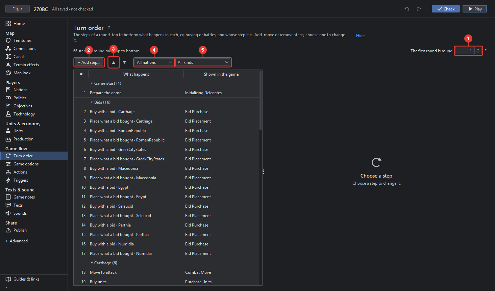

# Turn order

[← Guide](README.md)

The steps of a round, top to bottom: what happens in each, for example buying or battles, and
whose step it is. Add, move or remove steps; choose one to change it.

1. **The first round is round**: the number the game counts from, 1 unless the map starts later
   in a war. The "?" explains it.
2. **+ Add step…** adds a step after the chosen one: pick what happens in it and whose it is.
3. **▲ ▼** move the chosen step up or down; with a band chosen, a nation's whole run of steps
   moves.
4. The first box shows one nation's steps; the second the steps where one thing happens, for
   example every battle step.
5. The table: each row a step with its nation, what happens in it, how often it runs and its
   name in the game. The steps of one nation form a band.

A step, once chosen, shows on the right:

- **Nation** whose step it is, or none for a step of the whole round, for example the round's
  end.
- **What happens**: the kind of step, in plain words, from TripleA's delegates: buying, tech,
  combat move, battles, non-combat move, placing, end of turn, and so on. The kind also sets the
  ending of the step's name, by which TripleA tells combat from non-combat move.
- **Runs**: **Every round** or **Only in the first** so many rounds, for example a bid step.
- **Name in game**: the step's name in the game file, made from the nation and the kind unless
  you type one.
- **Remove step** takes it out. Check (F6) says when a nation lacks a step it needs.
