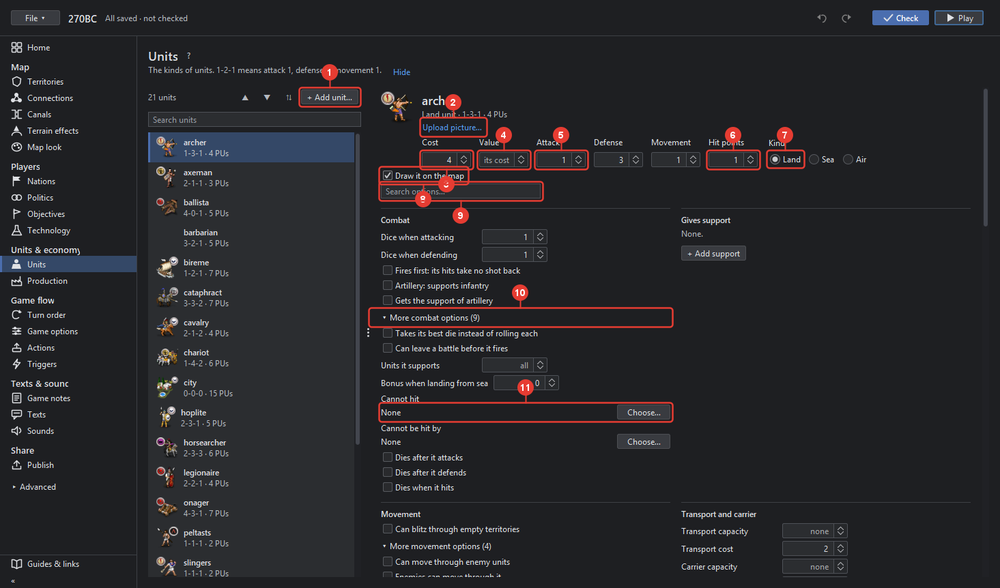
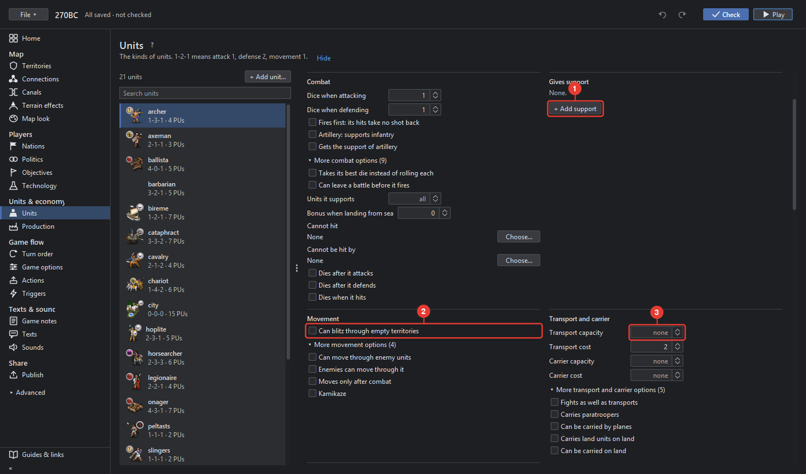
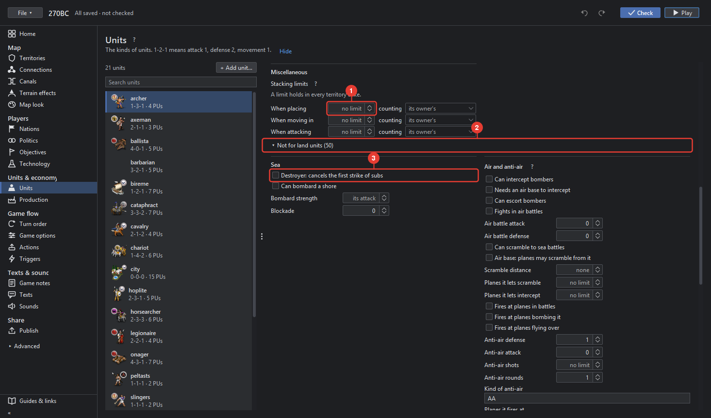
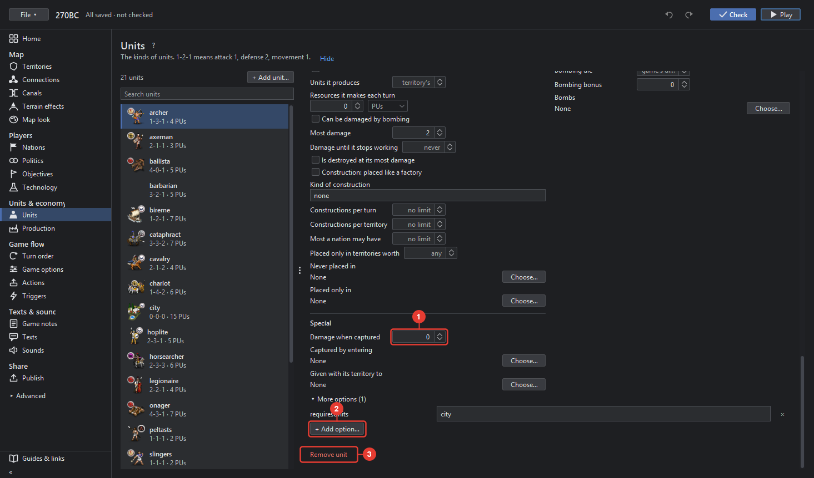

# Units

[← Guide](README.md)

The kinds of units. 1-2-1 means attack 1, defense 2, movement 1. The list on the left shows each
unit type with its picture and its numbers; a click chooses it. Every option of the game's
unitAttachment is here, in plain words, grouped as a map maker thinks of them; the game's name
for an option is in the tool tip of its label.

1. **+ Add unit…** makes a unit type: a name, the unit to start from as a copy, and maybe a
   picture. **▲ ▼** before it move the chosen unit in the game's list, which is the order TripleA
   lists and draws the units in; **⇅** orders the whole list in one step: A to Z, by cost or by
   kind as TripleA's own buy tabs group units. Undo takes an order back.
2. **Upload picture…** gives the unit its own picture, for every nation or tinted per nation;
   **Use the game's picture** takes it back. The list shows each unit's picture as the first
   nation shows it.
3. **Cost**: PUs to buy one, from the purchase list that sells it; "–" when no rule sells it.
4. **Value** (tuv): what the unit is worth to the AI and the battle calculator; empty for its
   cost. Set it for a unit that is free or cheap but strong.
5. **Attack**, **Defense**, **Movement**: the numbers of the list's line. **Attack** hits on a
   die roll of this or less, **Defense** when defending, **Movement** territories per turn.
6. **Hit points**: hits it takes to destroy, for example 2 for a battleship.
7. **Kind**: Land, Sea or Air. It decides which sections apply; a unit that both sails and flies
   sets both in the Sea and Air sections.
8. **Draw it on the map**: off, the game draws it nowhere and leaves it out of its unit
   statistics, for a unit that only marks something.
9. **Search options** finds an option by its words here or its name in the game's XML; the
   sections then show only what matches.
10. **More … options** folds the rarer options of a section; Show all options in the File menu
    opens them all.
11. Lists of unit types, nations or territories show as a sentence with **Choose…**, which ticks
    them in a dialog.

Each section shows its common options and those set; the rest wait behind its More row. A section
that is not for the unit's kind, for example Sea for a land unit, is folded into "Not for land
units" with the others.

- **Combat**: Dice when attacking, Dice when defending, Fires first: its hits take no shot back,
  Artillery: supports infantry, Gets the support of artillery; more: Takes its best die instead of
  rolling each, Can leave a battle before it fires, Units it supports, Bonus when landing from sea,
  Cannot hit, Cannot be hit by, Dies after it attacks, Dies after it defends, Dies when it hits.

1. **Gives support**: the supports the unit gives, like artillery, each a sentence such as "+1
   attack to 1 allied infantry when attacking", green for a help to allies, red for a harm to
   enemies. **Edit** opens it: Supports (unit types), When (attacking, defending), Whose units
   (allied, enemy), Bonus, To (strength, rolls), Units one supports, Kind of bonus, Nations.
   × removes it; **+ Add support** adds one that starts as +1 attack to one allied infantry. A
   support written once for every unit of a variable shows read-only with a link to Attachments.
2. **Movement**: Can blitz through empty territories; more: Can move through enemy units, Enemies
   can move through it, Moves only after combat, Kamikaze.
3. **Transport and carrier**: Transport capacity, Transport cost, Carrier capacity, Carrier cost;
   more: Fights as well as transports, Carries paratroopers, Can be carried by planes, Carries
   land units on land, Can be carried on land.

1. **Miscellaneous → Stacking limits**: at most so many of this unit type in a territory **When
   placing**, **When moving in** and **When attacking**, each **counting** its owner's, its
   owner's and allies', or everyone's. Blank is no limit. Below, the nations' limits that count
   this unit, from Nations, each once with the nations it holds for.
2. **Not for land units**: the sections of the other kinds, folded, with their count.
3. **Sea**: Sails, Destroyer: cancels the first strike of subs, Can bombard a shore, Bombard
   strength, Blockade. **Air and anti-air**: Flies, Can intercept bombers, Needs an air base to
   intercept, Can escort bombers, Fights in air battles, Air battle attack and defense, Can
   scramble to sea battles, Air base, Scramble distance, Planes it lets scramble and intercept,
   Fires at planes in battles, Fires at planes bombing it, Fires at planes flying over, Anti-air
   defense and attack, Anti-air shots and rounds, Kind of anti-air, Planes it fires at, May fire
   more shots than there are planes, Its anti-air can be damaged, Rocket: fires at factories.
   The "?" of the section explains the order of fire in a battle.

- **Production and infrastructure**: Infrastructure, eg a factory; Produces units; Units it
  produces; Resources it makes each turn, a count and a resource, a minus count for upkeep such
  as −1 PUs; Can be damaged by bombing; Most damage; Damage until it stops working; Is destroyed
  at its most damage; Construction: placed like a factory; Kind of construction; Constructions
  per turn and per territory; Most a nation may have; Placed only in territories worth; Never
  placed in; Placed only in.
- **Bombing**: Strategic bomber, Bombing die, Bombing bonus, Bombs.
1. **Special**: Damage when captured, Captured by entering, Given with its territory to.
2. **More options**: the options the sections do not show, as the game file has them, each with
   its name, a field and ×; a repeated or counted option is here too. **+ Add option…** adds any
   option TripleA's unitAttachment takes, by its name, with a hint of its format.
3. **Remove unit** takes the unit type out of the game, its rules and starting units with it.
